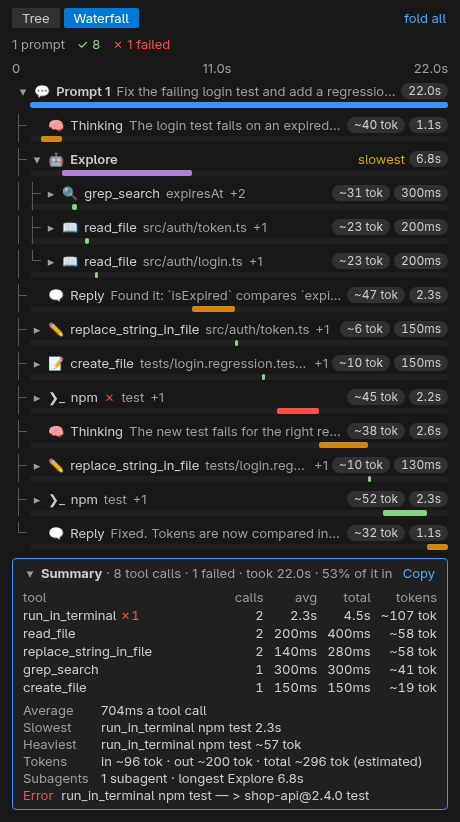
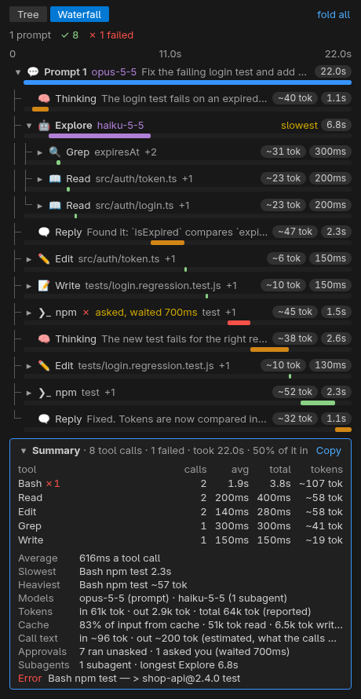
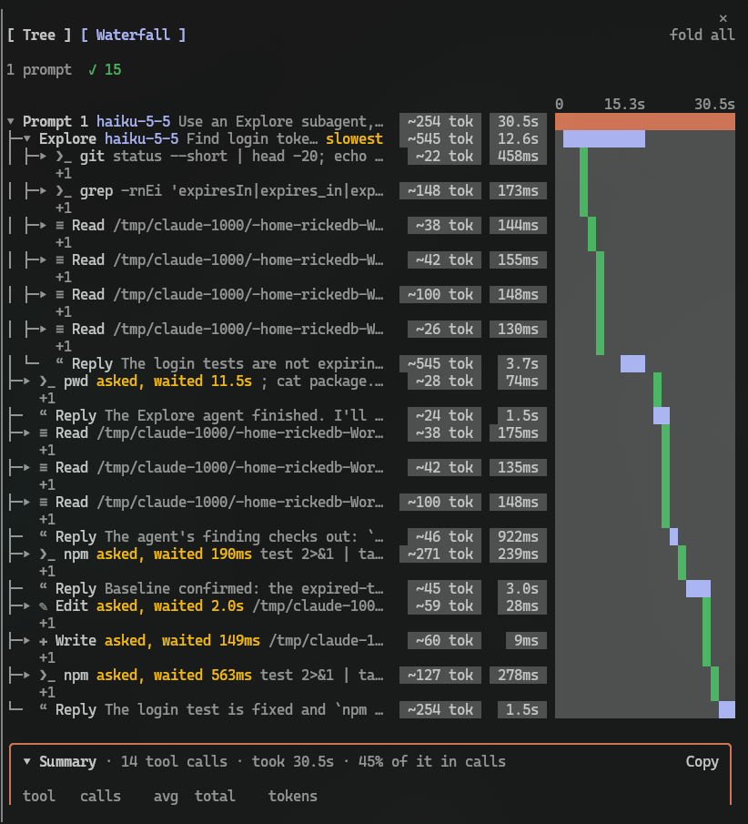
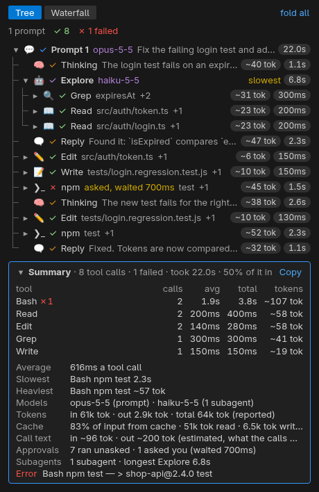
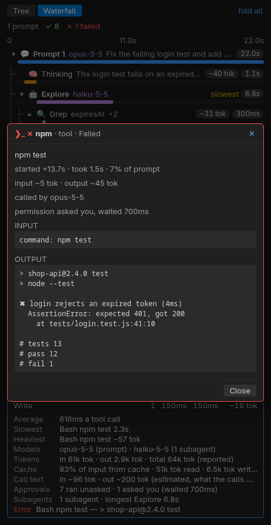

# Agent Call Stack

[](https://github.com/sponsors/rickedb)

See what a coding agent is doing while it works, as a live call stack: each prompt, what the model thought and replied between calls, the subagents it started and the tool calls inside them, with status, duration and the size of each output in tokens. Running calls are listed at the top as the current stack, innermost first. The view draws as a tree or a waterfall, and a row opens its input and output.

It exists for three agents, with the same features in each:

<p align="center">
  
  
</p>
<p align="center"><sub>Left: GitHub Copilot in VS Code. Right: Claude Code in VS Code, which also shows the model, the tokens the API counted and the approvals. The same made-up session in both, drawn by the extensions' own code.</sub></p>
<p align="center">
  
</p>
<p align="center"><sub>Claude Code in the terminal (the mod): a real screenshot of its pane during a real session, fixing a bug in a demo project.</sub></p>

## Pick your agent

| Agent | Folder | What it is | Install |
| --- | --- | --- | --- |
| GitHub Copilot in VS Code | [`vscode/`](vscode/README.md) | A hook script that records the agent's events, and an extension that draws the pane in the side bar. | The extension, then **Install Copilot Hooks** in its view. |
| Claude Code in VS Code | [`claude-vscode/`](claude-vscode/README.md) | The same idea for Claude Code's VS Code extension: a hook script records Claude Code's events, and a separate extension draws the pane and reads the model and token counts from Claude Code's transcript. | The extension, then **Add to your settings** in its view. |
| Claude Code (terminal and desktop) | [`claude/`](claude/README.md) | A Claude Code mod: hooks on the engine's events and a pane beside the chat. | `/plugin install agent-call-stack --marketplace Rickedb/agent-call-stack` |

The targets keep the same features; what differs is listed in [AGENTS.md](AGENTS.md), which is also the rule for changing any of them. The Claude Code marketplace manifest stays in `.claude-plugin/` at the root and points at `claude/`.

## What you see

- **The stack.** What runs right now, innermost first.
- **A tree or a waterfall.** The same rows nested with status marks, or as bars on a time axis that show what overlapped.
- **What the model wrote.** A `Thinking` and a `Reply` row in order among the calls.
- **Subagents** as rows holding their own calls, and what each call involved (files, addresses, commands, searches), named by what it ran (`npm`, not `cd`).
- **Details of a row**: state, timing, sizes, and its input and output, with *Show all* and copy.
- **A summary of each finished prompt**: calls, failures, time, a line per tool, the slowest and heaviest call, tokens, and a markdown copy for a ticket or a PR.
- **Errors and compactions** as rows of their own.

<p align="center">
  
  
</p>

Each README has a tour with more pictures: [Copilot](vscode/README.md#a-tour) and [Claude Code in VS Code](claude-vscode/README.md#a-tour). The terminal pane of the [Claude Code mod](claude/README.md) has its own tour, with real screenshots.

## Reference

The details of what each target shows and how it works. Each target's own README is a short summary.

### Hooks, node and Windows (the VS Code extensions)

Both VS Code extensions record through hooks that run `node record.cjs <Event>` (the script is copied to `~/.copilot/agent-call-stack/` for Copilot, `~/.claude/agent-call-stack-vscode/` for Claude Code in VS Code).

- **Which node.** A hook is started by a plain, non-interactive shell, which has not read your shell config, so a `node` that only a version manager (mise, nvm, fnm, volta) adds to `PATH` there is "not found". The install therefore looks node up itself (`PATH`, the usual version-manager folders, then your login shell) and writes its full path into the hooks. The extension rewrites the hook entries each time it activates, so a moved node is picked up after a window reload.
- **No node.** With none found, the hooks run VS Code itself as node (`ELECTRON_RUN_AS_NODE=1`). The setting `agentCallStack.useElectronAsNode` (Copilot) or `agentCallStackClaude.useElectronAsNode` (Claude) makes that the choice even when node exists. Reload the window after changing it.
- **Windows.** A `node` on `PATH` is used as it is. With none, or with the setting on, the hooks call a small `record.cmd` the extension writes (next to the recorder, or in `%ProgramData%` when your user folder has a space in it) that sets `ELECTRON_RUN_AS_NODE` and runs VS Code. A bare path with an argument runs the same in cmd, PowerShell and Git Bash. It has not been tried on every Windows setup: if the hooks fail there, install Node LTS.
- **Other requirements.** VS Code 1.95+. For Copilot, agent hooks enabled (`chat.useHooks`; a preview feature your organization may disable). For Claude Code, settings that do not set `disableAllHooks`.
- **Commands.** Copilot: *Open Call Stack*, *Install Copilot Hooks*, *Remove Copilot Hooks*, *Clear Recorded Calls*, and `@callstack` in chat for the tree as text. Claude Code in VS Code: *Open Call Stack*, *Add Hooks to Claude Code Settings*, *Remove Hooks from Claude Code Settings*, *Clear Recorded Calls*. Setting `defaultView` picks Tree or Waterfall at first.

### GitHub Copilot in VS Code (`vscode/`)

<details>
<summary>How it works, what it reads, how it differs, and the code layout</summary>

#### How it works

Copilot has no in-process plugin API like Claude Code's mods, so the port has two parts:

1. **A hook script** (`src/record.ts`, installed as `~/.copilot/agent-call-stack/record.cjs`). Copilot [agent hooks](https://code.visualstudio.com/docs/copilot/customization/hooks) run it on each event (`UserPromptSubmit`, `PreToolUse`, `PostToolUse`, `SubagentStart`, ...). It appends one normalized line to `~/.copilot/agent-call-stack/events/<session>.jsonl`. It never blocks or denies anything, prints `{}`, and swallows its own errors. Texts over 8,000 characters are cut in the log and kept whole in `blobs/`.
2. **A VS Code extension** (`src/extension.ts`) that tails those logs and draws the pane in the side bar (the Activity Bar's **Agent Call Stack** icon), with the same Tree / Waterfall views, folding, details, "Show all" and copy buttons.

What maps to what:

| Claude Code mod | Copilot port |
| --- | --- |
| `turn.start` / `turn.complete` | `UserPromptSubmit` / `Stop` |
| `tool.call` | `PreToolUse` / `PostToolUse` / `PostToolUseFailure` |
| `agent.spawn` | `SubagentStart` / `SubagentStop` (plus the spawn tool's description) |
| `ui.open` pane, `/call-stack` | Side bar view, `Agent Call Stack: Open Call Stack`, and `@callstack` in chat (text tree) |
| State atoms | Extension host state (view mode is remembered) |

#### Details

Click a row to open its details in a modal over the view: its state, timing, token sizes, who it ran with, and its input and output (*Show all*, *Copy*). The ✕, the Close button, a click outside it, or Esc closes it. Nothing expands inline, so rows never shift. (The Claude Code mod opens details inline: its engine has no modal.)

#### Reading the tree

- **Nesting.** A subagent is a row, and the calls it makes are its children. Guide lines (`├─ └─`) draw the branches. Neither Copilot's hooks nor the engine say which tool call started another, so a tool that calls other tools shows as siblings, not as parent and child; only subagents nest.
- **What a call involved.** Under a tool call's row, in the tree and the waterfall, once you open it, one row for each thing it involved: a file (its name only, with what was done to it and, for an edit, its lines: `◦ login.ts edit +2 −1`), an address it fetched (`↗ x.dev/docs/auth fetch`, the scheme left off), the command it ran (`$ npm test run`), what it searched for (`? login search`). The rows have no time or bar of their own. A click on one opens in the modal the whole path, address or command, what the call did, and every call of the prompt that involved the same one (each a button that opens that call's details), with their lines in all; *Open the call* goes to the call itself. They are shut until you open them: a call with something under it has an arrow (`▸`, and a `+2` after it counting them), and a click on it opens them (`▾`) or shuts them again; *fold all* shuts them too. Over eight, the rest are counted (`+3 more`). They are read from what each call was given, (see *What a call touched*), so they show while the call runs. `@callstack` lists them too.
- **Names and icons.** A shell call is named by the first command it runs that is not a common call: `cd /app && npm test` is `npm` with `test` after it, and `cd`, `pushd`, `export`, `set`, `source`, `clear`, `Set-Location`, `$env:X = ...` and the like only say where or with what, so they are passed over (so are `VAR=x` settings before a program). A line that runs no program of its own is named by its shell: `bash`, or `pwsh` for a PowerShell call (by the tool's name, a cmdlet such as `Get-ChildItem`, or a `$env:` setting). The icon says what the call did: `❯_` for a command (the terminal's prompt), 📖 read, ✏️ edit, 📝 write, 🔍 search, 🌐 fetch; `🔌` a tool an MCP server gave the agent (named `mcp__server__tool`, or `mcp_server_tool` in Copilot), whatever it touched; a call that touched nothing mapped keeps the 🔧 tool icon. The summary still groups by the tool's own name.
- **The commands of a shell call.** Its details list the commands of the line as a tree, names only, in the order they run: pipelines joined by `&&` (next runs if this succeeded), `||` (if it failed), `;` and `&` at the top, and each pipeline's later commands under the one that feeds them, after a `|` (or `|&`). Each operator has its own color, and a line under the tree says what the ones used mean. The common calls are dim. A line of one command shows no tree. Quotes and `$(...)` hide the operators inside them.
- **Badges and copy.** A row's output size and time are badges (the time is what the call itself took, a prompt's its total; the bar shows where it started). Each input and output text has a copy icon in the top-right corner of its code block, shown on hover as in a markdown preview, which copies the whole text and turns into a check for a moment; "Copy file path" and "Show all" stay as text buttons below it.
- **Status marks.** The tree puts a glyph on every row (`✓` done, `●` running, `✗` failed). The waterfall does not: the color of a row's bar already says done or running, so only a failure keeps its `✗`, after the name.
- **Parallel calls are not marked.** Copilot's hooks do not say which calls were started together, and overlap in time alone cannot tell parallel from coincidence, so the tree does not guess. In the waterfall, overlapping bars still show what ran at the same moment.

#### Tokens

Each row shows the size of its output in tokens (`~340 tok`, hover for what it means), and a row's details show both the input and the output. These are estimates, at four characters a token, from the whole text: Copilot's hooks give no token counts. The Claude Code mod shows the same figures, estimated the same way.

#### What a call touched

The resource rows under a tool call (see *Reading the tree*) are read from what the call was given, so they show while it runs: by the tool's name and the shape of its arguments (`filePath`, `command`, `url`, a list of replacements...), which Copilot's tool names make a heuristic: a tool the recorder does not recognize by name still lists the files it was given, as touched in some way (`·`). A call that touches nothing of these has no rows. The **lines** count what the call's arguments say: an edit counts the lines that differ between the text it replaces and its replacement (what the two share at the start and the end is left out), a file written whole counts as added only (the call does not say what was there), and a failed call counts for nothing. A change made by a shell command (`sed -i`, `git checkout`) is not counted. `apply_patch` is read from its patch, which also names its files. Only calls recorded after this update have rows, the lines and the fetched addresses (older logs show none).

#### Errors and compactions

- **Errors.** An `ErrorOccurred` event is an `Error` row under what was running, with the message in its name and, in its details, the error's name, its context (`model_call`, `tool_execution`, `system`, `user_input`), whether it was recoverable, and the stack. It does not fail the prompt: the host may go on. A session that ends while a prompt runs (`SessionEnd` with `abort`, `error` or `timeout`) fails the prompt, with `interrupted`, `session error` or `timed out` in red after its name. A failed call keeps its error as its output. The summary lists every failure (the prompt, subagents, calls, with the first line of each error), five at most.
- **Compactions.** A `PreCompact` event is a `Compact` row under what was running, with its trigger (`manual` or `auto`) and the instructions it was given. The hook fires before the compaction and nothing fires after, so the row is an instant: no length, no size before and after, no summary. The summary of the prompt counts them.

Neither counts as a call in the totals. After an update the extension rewrites the hook files it wrote, so the two events are recorded without a reinstall. VS Code's own docs list `PreCompact` but not `ErrorOccurred`; if errors never show up, VS Code does not fire it.

#### Transcript

Copilot's hooks name the file the chat's transcript is kept in, on a turn's end (`Stop`), a subagent's start and stop, and a compaction. The row's details show that path, with a button that copies it. A running prompt has none yet, and not every host sends it.

When the transcript is available, the tree also shows a `Thinking` row for the model's reasoning text and a `Reply` row for each nonempty assistant message, under the prompt (or a subagent with its own transcript). They are read from the transcript's `assistant.message` entries, not the hooks; their displayed time runs from the preceding transcript entry to the message. The transcript can be written asynchronously, so these rows may appear shortly after the turn ends. The file format is VS Code's own and undocumented; if it changes, these rows may be unavailable.

#### Summary of a finished prompt

When a prompt has finished and made at least one call, a summary ends its rows (not while it runs, when it is folded, or for a prompt read back from history):

- **Calls**: the tool calls, how many failed, how long the prompt took, and how much of that some call was running (overlaps count once).
- **By tool**: one line per tool, the most called first, with its calls, average time, total time and tokens, and its failures.
- **Average**, **slowest** and **heaviest** call (the one that moved the most text, in plus out).
- **Tokens**: in (the prompt and every call's input), out (the answer and every call's output) and the total. Estimates, as above: Copilot's hooks give no token counts. `@callstack` ends with the same figures as text.
- **Subagents**: how many, how many failed, and the longest. They are not counted as tool calls, and their time overlaps their own calls.
- **Compacts** and **Error** lines, as in the section above.

The summary collapses to its header with a click on `▾ Summary` (`▸` when collapsed); the copy button stays in the header. It is remembered until the window reloads.

**Copy** (a button on the summary's header) puts the whole summary on the clipboard as markdown: a bullet list of the figures and a table with every tool, for a ticket, a PR or a chat. `src/view/markdown.ts` builds it.

#### Differences from the Claude Code mod

- **Tokens are all estimates.** The Claude Code mod shows what the API reported for a prompt and each subagent, and the cache split; Copilot's hooks carry no usage.
- **The model is read, not given.** Copilot's hooks carry no model, so a prompt's is read from VS Code's own chat log (`chatSessions/<session id>.jsonl` beside the workspace's storage), the model each request was sent to, and matched to the prompts the hooks saw by order from the newest end. It is shown after the prompt's name, in a call's details ("called by"), and in the summary. That file's format is VS Code's own and not documented, so it can change under us; when the model is not found (or the chat is `auto` and says only that), nothing is shown. A subagent has no model of its own here.
- **No permission verdicts.** The Claude Code mod tags a call that was asked about, denied or not allowed, and tells the person's wait from the tool's run time. Copilot's hooks carry no verdict, so a call that waits for you to approve it shows the wait as part of its time.
- **Thinner errors and compactions.** No API error kind, no refusal category, no reply cut off at a limit; a compaction has its trigger and instructions but no size, no length, no summary.
- **No history backfill.** The mod read the chat's earlier messages when it loaded. Here only what happens after the hooks are installed is recorded (the log does survive reloads, so earlier recorded sessions come back).
- **Call pairing is best effort.** Some Copilot hosts give tool calls no id. Then a result is paired with its call by tool and arguments, oldest first, which can swap two identical parallel calls.
- **Subagents.** Copilot's start event may carry no subagent id. Calls inside a subagent are bound to the oldest subagent still waiting for one. The built-in `general-purpose` agent may fire no start/stop events at all (per GitHub's docs), and then it is not drawn.
- A call denied by policy never gets a result; it is drawn as failed when its prompt ends.
- Several concurrent chats each have a session; use the drop-down to switch (default: the newest one in this workspace).

#### Layout

Besides the panel, `src/chatmodels.ts` reads the model of each prompt from VS Code's chat log, `src/stats.ts` works out the summary's numbers, and `src/resources.ts` what a call involved, `src/names.ts` a call's name on its row (what a call touched is read in `src/record.ts`).

The panel's drawing is one file a concern in `src/view/`, with `src/render.ts` as its one door:

```
src/view/index.ts     renderBody: toolbar, counts, a section per prompt (newest first), the modal
src/view/rows.ts      a prompt's rows: guide lines, bars
src/view/sequence.ts  a shell call's commands as a tree
src/view/report.ts    the summary of a finished prompt (numbers from src/stats.ts)
src/view/markdown.ts  the summary as markdown, for its copy button
src/view/modal.ts     a row's details in the modal
src/view/blocks.ts    one input or output text, with Show all and Copy
src/view/toolbar.ts   the buttons, the counts, the empty state
src/view/text.ts      the tree as plain text, for @callstack
src/view/context.ts   what one draw works out once (children, times)
src/view/format.ts    escaping, durations, token estimates, status marks
src/view/types.ts     the view state the extension keeps, the draw context
media/                the webview's script (Esc, focus, redraws) and stylesheet
```

</details>

### Claude Code in VS Code (`claude-vscode/`)

<details>
<summary>How it works, what it reads, how it differs, and the code layout</summary>

#### How it works

Claude Code runs the hooks of its settings wherever it runs, the VS Code extension included, so the port has two parts, as the Copilot one has:

1. **A hook script** (`src/record.ts`, installed as `~/.claude/agent-call-stack-vscode/record.cjs`). Claude Code runs it on each event. It appends one normalized line to `~/.claude/agent-call-stack-vscode/events/<session>.jsonl`, prints nothing (for a hook, "no decision": it never blocks or denies anything) and swallows its own errors. Texts over 8,000 characters are cut in the log and kept whole in `blobs/`.
2. **A VS Code extension** (`src/extension.ts`) that tails those logs, reads the model and token counts from Claude Code's transcript, and draws the pane in the side bar (the Activity Bar's **Agent Call Stack for Claude** icon).

What maps to what:

| Claude Code mod | This extension |
| --- | --- |
| `turn.start` / `turn.complete` | `UserPromptSubmit` / `Stop` (`StopFailure` when the API failed) |
| `tool.call` | `PreToolUse` / `PostToolUse` / `PostToolUseFailure` (exact: every call has an id) |
| `agent.spawn` | `SubagentStart` / `SubagentStop` (plus the spawn call's description) |
| `tool.check` | `PermissionRequest` / `PermissionDenied` (only for a call you were asked about) |
| `session.compact` | `PreCompact` / `PostCompact` |
| a turn's reported usage and model | the transcript Claude Code keeps (`transcript_path` in every payload) |
| `turn.step`'s text and thinking chunks (the `Thinking` and `Reply` rows) | the same transcript's `text` and `thinking` blocks, a moment later |
| `ui.open` pane | the side bar view |

#### Reading the tree

- **Nesting.** A subagent is a row, and the calls it makes are its children (exact: a call carries its subagent's id). Guide lines (`├─ └─`) draw the branches. Neither Claude Code's hooks nor its engine say which tool call started another, so a tool that calls other tools shows as siblings.
- **What a call involved.** Under a tool call's row, in the tree and the waterfall, once you open it, one row for each thing it involved: a file (its name only, with what was done to it and, for an edit, its lines: `◦ login.ts edit +2 −1`), an address it fetched (`↗ x.dev/docs/auth fetch`, the scheme left off), the command it ran (`$ npm test run`), what it searched for (`? login search`). The rows have no time or bar of their own. A click on one opens in the modal the whole path, address or command, what the call did, and every call of the prompt that involved the same one (each a button that opens that call's details), with their lines in all; *Open the call* goes to the call itself. They are shut until you open them: a call with something under it has an arrow (`▸`, and a `+2` after it counting them), and a click on it opens them (`▾`) or shuts them again; *fold all* shuts them too. Over eight, the rest are counted (`+3 more`). They are read from what each call was given, (see *What a call touched*), so they show while the call runs.
- **What the model wrote between calls.** A `Thinking` row (🧠) and a `Reply` row (🗨️) sit in time order among the calls, under the prompt or subagent whose loop wrote them: the text the model wrote before it asked for a call ("I'll read the config first"), and its reasoning. They are read from the transcript (hooks carry none of it), so they show a moment after they are written, and a subagent's once it has stopped (its own transcript's path comes with its stop). A row's time runs from the line before it in the transcript to the line itself, so it is the model's own time on that block; its badge is the text's estimated tokens; its details show the text (cut at 8,000 characters). Thinking shows only when the model returned its text: some models and settings return a signature and no text, and then there is no row. They are not calls: the summary and the counts leave them out. Earlier chat (History) gets them too, since they come from the same file.
- **Names and icons.** A shell call is named by the first command it runs that is not a common call: `cd /app && npm test` is `npm` with `test` after it, and `cd`, `pushd`, `export`, `set`, `source`, `clear`, `Set-Location`, `$env:X = ...` and the like only say where or with what, so they are passed over (so are `VAR=x` settings before a program). A line that runs no program of its own is named by its shell: `bash`, or `pwsh` for a PowerShell call (by the tool's name, a cmdlet such as `Get-ChildItem`, or a `$env:` setting). The icon says what the call did: `❯_` for a command (the terminal's prompt), 📖 read, ✏️ edit, 📝 write, 🔍 search, 🌐 fetch; `🔌` a tool an MCP server gave the agent (named `mcp__server__tool`, or `mcp_server_tool` in Copilot), whatever it touched; a call that touched nothing mapped keeps the 🔧 tool icon. The summary still groups by the tool's own name.
- **The commands of a shell call.** Its details list the commands of the line as a tree, names only, in the order they run: pipelines joined by `&&` (next runs if this succeeded), `||` (if it failed), `;` and `&` at the top, and each pipeline's later commands under the one that feeds them, after a `|` (or `|&`). Each operator has its own color, and a line under the tree says what the ones used mean. The common calls are dim. A line of one command shows no tree. Quotes and `$(...)` hide the operators inside them.
- **Details.** Click a row to open its details in a modal: its state, timing, token sizes, the model, what you were asked, and its input and output (*Show all*, *Copy*, the transcript path). The ✕, Close, a click outside it, or Esc closes it.
- **Badges and copy.** A row's output size and time are badges (the time is what the call itself took, a prompt's its total; the bar shows where it started). Each text has a copy icon in its code block's corner.
- **Status marks.** The tree puts a glyph on every row (`✓` done, `●` running, `✗` failed). The waterfall does not: the bar's color already says it, so only a failure keeps its `✗`.
- **Parallel calls are not marked**: overlap in time alone cannot tell parallel from coincidence. In the waterfall, overlapping bars still show what ran together.

#### Models and tokens

A prompt and each subagent show the model that answered, in color after their name (`opus-5-5`; the date a model id carries is dropped). Tokens are of two kinds:

- **Reported** (`4.8k tok`, no `~`): what the API counted for a prompt's turns and for each subagent's loop, read from the transcript. A prompt's excludes its subagents, which have their own rows. The summary adds them up and says how much came from the cache.
- **Estimated** (`~340 tok`): a tool call's input and output, and the text of a prompt or subagent, at four characters a token. The summary's "Call text" line.

Claude Code's hooks carry neither, so both come from its transcript. The transcript's format is Claude Code's own and not documented, and it is written asynchronously: a turn's figures show a moment after it ends, a subagent's once it has stopped, and nothing shows if the format changes. The reader goes on from where it was in the file, so a long one is not read again.

#### Errors, compactions and approvals

- **Errors.** A prompt that did not end in an answer says why, in red after its name: what the API said (`rate limited: …`, `API overloaded`, `billing error`), or `session ended` when the session closed on it. A failed call keeps its error as its output. The summary lists every failure (the prompt, subagents, calls, with the first line of each error), five at most.
- **Compactions.** A `Compact` row from `PreCompact` to `PostCompact`, under what was running, with its trigger (`manual` or `auto`), the instructions it was given (input), the summary it left (output) and, from the transcript, `180k → 12k tok`. The summary of the prompt adds them up.
- **Approvals.** A call you were asked about is tagged `asking you` while it waits, then `asked, waited 4.2s`; one not allowed is tagged `not allowed` (you said no, or a classifier did, with its reason). Claude Code reports how long the tool itself ran (`duration_ms`, without your answer), so the row is drawn from when it ran and the wait is told apart; the summary says how many calls ran unasked, how many you were asked about, and how long you were waited on.

Error and compaction rows count as neither calls nor failed calls in the totals.

#### What a call touched

The resource rows under a tool call (see *Reading the tree*) are read from what the call was given, by the tool's name and the shape of its arguments, so they also work for tools it has not seen. The **lines** count what the call's arguments say: an edit counts the lines that differ between the text it replaces and its replacement (what the two share at the start and the end is left out), a file written whole counts as added only (the call does not say what was there), and a failed call counts for nothing. A change made by a shell command (`sed -i`, `git checkout`) is not counted. The rows and the lines come only with calls recorded after this update.

#### History

When the view first draws a session, what the chat held before the hooks were added (or before a resumed session started) is read back from Claude Code's transcript, like the mod reads the chat when it loads: the prompts, each call with what came back, subagent calls, and the compactions, newest 30 prompts at most and the end of a transcript over 64 MB. They go before the recorded ones, folded as older prompts are, marked in their details as read back. A prompt the hooks began in the middle of takes its words and earlier calls from the transcript and keeps what the hooks saw. Rows read back have the times the lines were written (a wait for you is in them), no verdicts, and no inside of a subagent. A session that never fired a hook is not known to the view, so it has no history either.

#### Summary of a finished prompt

When a prompt has finished and made at least one call, a summary ends its rows: the calls, how many failed and how long they ran of the prompt's time; one line per tool (calls, average, total, tokens); the average, slowest and heaviest call; the models; the tokens (reported, with the cache and the call text estimate) ; approvals, compactions, subagents and errors. It collapses to its header with `▾ Summary`, and **Copy** puts it on the clipboard as markdown.

#### Differences from the Claude Code mod and the Copilot port

- **History has no verdicts and wall-clock times.** What the chat held before the hooks is read back from the transcript (see History), where a call's time includes any wait for you and nothing says what you were asked.
- **Approvals are partial.** The hooks tell of a call only when you are asked or a classifier refuses it, so there is no rule name for the rest, which show nothing.
- **No refusal category, no cut-off replies, no compaction cost.** Those are engine events the mod sees (`turn.step`, `session.compact`); a hook does not.
- **Thinking and reply rows come a moment late too**, from the same file: the mod streams them live (running, then settled), the extension draws each once its line is written, and a subagent's once it has stopped.
- **Tokens and models come a moment late**, and from a file whose format may change (see above).
- **No `/call-stack` and no `@callstack`.** The view's icon, or the command, opens it.
- **A hook install step**, which merges into your settings (see *Hooks, node and Windows* above).

`AGENTS.md` at the repository root lists these with the reasons.

#### Layout

```
src/record.ts         the hook script: a Claude Code payload to one log line, what a call touched
src/hooks.ts          adding our hooks to a settings file, and taking them out (pure merge, backup)
src/store.ts          tails the event logs
src/model.ts          folds events into rows: calls, subagents, asks, compactions, failures
src/transcript.ts     reads the model and usage of each prompt and subagent from the transcript
src/history.ts        reads the earlier prompts, calls and compactions back from the transcript
src/stats.ts          the summary's numbers; src/resources.ts what a call involved; src/names.ts a call's name on its row
src/extension.ts      the view, the commands, the installer
src/view/             the panel's drawing: rows, modal, blocks, report, markdown, sequence, toolbar, tags, format
media/                the webview's script and stylesheet
```

</details>

### Claude Code mod (`claude/`)

<details>
<summary>What it shows, how it differs, and the code layout</summary>

#### Reading the tree

- **Nesting.** A subagent is a row, and the calls it makes are its children. Guide lines (`├─ └─`) draw the branches. Neither Copilot's hooks nor the engine say which tool call started another, so a tool that calls other tools shows as siblings, not as parent and child; only subagents nest.
- **What a call involved.** Under a tool call's row, in the tree and the waterfall, once you open it, one row for each thing it involved: a file (its name only, with what was done to it and, for an edit, its lines: `◦ login.ts edit +2 −1`), an address it fetched (`↗ x.dev/docs/auth fetch`, the scheme left off), the command it ran (`$ npm test run`), what it searched for (`? login search`). The rows have no time or bar of their own. A click on one opens inline under the row the whole path, address or command, what the call did, and every call of the prompt that involved the same one (each a button that opens that call's details), with their lines in all; *Open the call* goes to the call itself. They are shut until you open them: a call with something under it has an arrow (`▸`, and a `+2` after it counting them), and a click on it opens them (`▾`) or shuts them again; *fold all* shuts them too. Over eight, the rest are counted (`+3 more`). They are read from what each call was given, (see *What a call touched*), so they show while the call runs.
- **What the model wrote between calls.** A `Thinking` row (`∴`) and a `Reply` row (`“`) sit in order among the calls, under the prompt or subagent whose loop wrote them: the text the model streams before it asks for a call ("I'll read the config first"), and its reasoning. They come from the `turn.step` stream, so a block shows as running from its first piece and settles when the step ends, with its whole text (its details show it, cut at 8,000 characters in the state and whole in a file beyond that). A row's time is how long the model took to write it, and its badge the text's estimated tokens. Thinking shows only when the model returns its text: some models and settings return a signature and no text, and then there is no row. They are not calls: the summary and the counts leave them out. What the chat held before the mod loaded (History) has none, since the engine's message list gives no per-block text or times.
- **Names and icons.** A shell call is named by the first command it runs that is not a common call: `cd /app && npm test` is `npm` with `test` after it, and `cd`, `pushd`, `export`, `set`, `source`, `clear`, `Set-Location`, `$env:X = ...` and the like only say where or with what, so they are passed over (so are `VAR=x` settings before a program). A line that runs no program of its own is named by its shell: `bash`, or `pwsh` for a PowerShell call (by the tool's name, a cmdlet such as `Get-ChildItem`, or a `$env:` setting). The icon says what the call did: `❯_` for a command (the terminal's prompt), `≡` read, `✎` edit, `✚` write, `?` search, `↗` fetch, `◈` a tool an MCP server gave the agent (`mcp__server__tool`), whatever it touched (narrow characters, so the columns hold in every terminal); a call that touched nothing mapped keeps none. The summary still groups by the tool's own name.
- **The commands of a shell call.** Its details list the commands of the line as a tree, names only, in the order they run: pipelines joined by `&&` (next runs if this succeeded), `||` (if it failed), `;` and `&` at the top, and each pipeline's later commands under the one that feeds them, after a `|` (or `|&`). Each operator has its own color, and a line under the tree says what the ones used mean. The common calls are dim. A line of one command shows no tree. Quotes and `$(...)` hide the operators inside them.
- **Badges and copy.** A row's output size and time are badges (`~340 tok`, `400ms`). Each input and output text has a copy icon (`⧉`) in the top-right corner of its box, which copies the whole text; "Copy file path" and "Show all" stay as text buttons below it.
- **Status marks.** The tree puts a glyph on every row (`✓` done, `●` running, `✗` failed). The waterfall does not: the color of a row's bar already says done or running, so only a failure keeps its `✗`, after the name.
- **Parallel calls are not marked.** Neither the engine nor Copilot's hooks say which calls were started together, and overlap in time alone cannot tell parallel from coincidence, so the tree does not guess. In the waterfall, overlapping bars still show what ran at the same moment.

#### Tokens

Two kinds of figure, told apart in the pane:

- **Reported** (`4.8k tok`, no `~`): what the API counted for a prompt's turn and for each subagent's own turns, from `turn.complete`. A row's details say it (`reported in 4.8k tok (4.0k tok cached) · out 520 tok`); a prompt's excludes its subagents, which have their own rows. The summary adds them up (input counts what the cache served and wrote too) and says how much came from the cache.
- **Estimated** (`~340 tok`): what the API does not count per call, so a tool call's input and output, and the text of a prompt or subagent, at four characters a token from the whole text. Each row's output size and a row's details use these, and so does the summary's "Call text" line. A prompt with no reported usage (an interrupt, an API error) falls back to estimating all of it.

The [Copilot port](vscode/README.md) estimates everything: its hooks carry no usage.

#### Models

A prompt and each subagent show the model they ran on, in color after their name (`Prompt 1 opus-5-5`; the date a model id carries is dropped). A prompt's model is read from its first model response and settled at its end, from what the API says answered (a fallback can change it). A subagent's is the one its spawn resolved to. A tool call has none of its own: its details say which model called it, the model of the prompt or subagent it ran in. A finished prompt's summary lists the models used. The [Copilot port](vscode/README.md) shows the prompt's model only, read from VS Code's chat log, since its hooks carry none.

#### What a call touched

The resource rows under a tool call (see *Reading the tree*) are read from what the call was given, so they show while it runs: by the tool's name and the shape of its arguments (`file_path`, `command`, `url`, a list of edits...), so it also works for tools the mod has not seen. A call that touches nothing of these (a todo list, say) has no rows. The **lines** count what the call's arguments say: an edit counts the lines that differ between the text it replaces and its replacement (what the two share at the start and the end is left out), a file written whole counts as added only (the call does not say what was there), and a failed call counts for nothing. A change made by a shell command (`sed -i`, `git checkout`) is not counted.

#### Errors, compactions and approvals

Three things that happen to the work, beside the calls themselves.

- **Errors.** A prompt or a subagent that did not end in an answer says why, in red after its name (`interrupted`, `refused (category): ...`, or what the API said: `rate limited`, `API overloaded`, `billing error`, `hit the output limit`, with its details). A model reply cut off at the output limit or the context window is a failed `Error` row under the prompt. A failed call keeps its error as its output. The summary lists every failure (the prompt, subagents, calls, with the first line of each error), five at most.
- **Compactions.** Each is a `Compact` row under the prompt it happened in (a manual `/compact` goes under the last prompt), from when it began to when it ended, with its trigger (`manual` or `auto`) and, when the engine says, `180k → 12k tok`. Its details give the messages before and after, what the summarizing request cost (reported), the instructions it was given (input) and the summary it left (output). The summary of the prompt adds them up: how many, how many tokens they saved, how long they took. A precomputation, which installs nothing, is not drawn.
- **Approvals.** Each call carries the engine's verdict, from `tool.check`: a call put to you is tagged `asking you` while it waits, then `asked, waited 4.2s`; a call not allowed is tagged `denied` (a rule or the mode said no) or `not allowed` (you said no, or a classifier did). The details say which rule decided and why. A call you were asked about is drawn from when the tool ran (the engine reports it, with the wait and the hooks left out), so its time and bar are the tool's, and the wait is told apart: the summary says how many calls were allowed, asked or not allowed, and how long you were waited on in all.

Compaction and error rows count as neither calls nor failed calls in the pane's totals.

#### Transcript

A prompt's details give the path of the conversation's transcript file (from the `Stop` hook, so once the turn ends), and a subagent's its own (from `SubagentStop`), with a button that copies it. A running row has none yet. The VS Code port does the same with what Copilot's hooks give.

#### Summary of a finished prompt

When a prompt has finished and made at least one call, a summary ends its rows (not while it runs, when it is folded, or for a prompt read back from history):

- **Calls**: the tool calls, how many failed, how long the prompt took, and how much of that some call was running (overlaps count once).
- **By tool**: one line per tool, the most called first, with its calls, average time, total time and tokens, and its failures.
- **Average**, **slowest** and **heaviest** call (the one that moved the most text, in plus out).
- **Tokens**: in, out and total, as the API reported them for the prompt and its subagents; the **cache** line says how much input came from the cache, and **call text** the estimate of what the tools were given and returned. With no reported usage the tokens line is the estimate (the prompt and every call's input, the answer and every call's output).
- **Models**: the models the prompt and its subagents ran on.
- **Subagents**: how many, how many failed, and the longest. They are not counted as tool calls, and their time overlaps their own calls.
- **Approvals**, **Compacts** and **Error** lines, as in the section above.

The summary collapses to its header with a click on `▾ Summary` (`▸` when collapsed); the copy button stays in the header. A prompt's choice is kept.

**Copy** (a button on the summary's header) puts the whole summary on the clipboard as markdown: a bullet list of the figures and a table with every tool, for a ticket, a PR or a chat. `src/pane/markdown.ts` builds it.

#### Layout

```
hooks/hooks.json      names the one hooks module
hooks/register.tsx    wires the three parts below
src/lifecycle.tsx     opening the pane, /call-stack, the button that reopens it
src/recording.ts      turns, subagents and tool calls into rows
src/pane/             drawing the rows: index (reads state, picks the view),
                      toolbar, section, row, bar, details, block, widget, theme,
                      cells (the right-hand columns), report (the summary),
                      resource (a call's resource rows and their details), sequence (a shell call's commands), tags (what a row says beside its name)
src/stats.ts          the summary's numbers, from a prompt's rows, and modelOf
src/touch.ts          what a call touched, read from its arguments
src/names.ts          a call's name on its row (the program a shell call runs)
src/resources.ts      what a call involved: its files, addresses, command, search
src/state.ts          every atom, and every read and write of the state
src/history.ts        reads the chat's earlier messages into rows
src/nodes.ts          row bookkeeping: upsert, patch, keep (cut text to a file), guard
src/format.ts         text helpers: clip, describe, durations, token estimates
src/config.ts         limits and names
types/index.d.ts      the row type and the state the mod declares
```

The engine reads a hooks module by scanning its source, which sets two rules for splitting it:

- `$` may be passed to another file only into a `function` declaration, never an arrow function in a `const`, and never stored in an object. So helpers that take `$` are declared with `function`, and the pane parts take `$` as their first argument next to the context they draw from.
- The state scan wants each atom beside the `update` that writes it, so `src/state.ts` holds all the atoms and the rest of the mod calls its functions (`setMode($, ...)`, `toggleFolded($, id)`) instead of `read` and `update`.

`claude plugin validate .` reports a break of either rule, naming the file and line.

</details>

## Sponsor the project

Agent Call Stack is built and maintained on free time. If it saved you from guessing what your coding agent was doing, or your team uses it every day, consider sponsoring its development:

[](https://github.com/sponsors/rickedb)
[](https://www.buymeacoffee.com/rickedb)

* **[GitHub Sponsors](https://github.com/sponsors/rickedb)**: one-off or monthly, and it shows up right here on the repository.
* **[Buy me a coffee](https://www.buymeacoffee.com/rickedb)**: for a quick thank you.

Sponsoring keeps new features, support for more agents and bug fixes coming. Not in a position to sponsor? Starring the repository, reporting something that looks wrong or sending a pull request helps just as much.

## Pictures in the READMEs

**The two VS Code extensions.** The pictures are generated: [`scripts/screenshots/shots.cjs`](scripts/screenshots/shots.cjs) builds one made-up session ("fix the failing login test") with each extension's own model, renders it with the extension's own view code and stylesheet in a dark and a light theme, and captures the page with Electron into each extension's `docs/images/`. To redo them after a change to a view:

```bash
(cd vscode && npm install && npm run build)
(cd claude-vscode && npm install && npm run build)
ELECTRON=/path/to/electron node scripts/screenshots/shots.cjs
```

`ELECTRON` is an Electron binary: your distro's `electron`, or the one `npm i -D electron` installs. The images are kept out of the `.vsix` (`.vscodeignore`); the Marketplace page loads them from the repository.

**The Claude Code mod.** Its pictures (`claude/docs/images/`) are real screenshots, not renders: a terminal draws the pane, so the only faithful picture is the terminal's own. They were taken by running Claude Code with the plugin (`claude --plugin-dir claude`) in a terminal window on the small demo project in [`scripts/screenshots/demo/shop-api`](scripts/screenshots/demo/shop-api) (a real failing test: a token's expiry compared in the wrong unit), with the prompt *"Use an Explore subagent to find where login tokens expire, then fix the failing login test, add a regression test in tests/login.regression.test.js, and run npm test."* Then a screenshot of the pane for each view (**Tree**, **Waterfall**, a row's details, the summary scrolled into view). Copy the demo folder somewhere short first and `git init` it (a short path keeps the file paths in the rows readable), and use an opaque terminal background.

## Icons

The artwork's full-size sources are in [`assets/`](assets/) (1254 px). The sizes each marketplace takes are made from them (cropped square to the artwork, Lanczos resize, transparent background: the source's dark backdrop is taken out, the panels are kept solid and the glow fades to transparent):

| File | Size | Used by |
| --- | --- | --- |
| `vscode/media/icon.png` | 256 × 256 | the Copilot extension's `icon` (VS Code Marketplace asks for at least 128 px, PNG, no SVG) |
| `claude-vscode/media/icon.png` | 256 × 256 | the Claude Code extension's `icon` (orange variant) |
| `vscode/media/icon.svg`, `claude-vscode/media/icon.svg` | 24 × 24 viewBox | the side bar (activity bar) icon. It has to be a single-colour SVG that takes the theme's colour, so the glowing artwork is redrawn flat: the top bar with its emblem (the Copilot robot for Copilot, a starburst for Claude) and the stack of bars below. |
| `claude/icon.png` | 512 × 512 | the Claude Code plugin (orange variant). Claude Code's plugin and marketplace manifests have no icon field, so the file sits beside the plugin for listings that ask for one. |

## Releasing the VS Code extensions

[`.github/workflows/ci.yml`](.github/workflows/ci.yml) tests and packs both extensions, and runs the Claude Code plugin's tests (`claude plugin test`), on every push to `master` and every pull request. [`.github/workflows/publish.yml`](.github/workflows/publish.yml) publishes `vscode/` and `claude-vscode/` to the Visual Studio Marketplace (and to Open VSX, if you set a token) and attaches the `.vsix` files to a GitHub release.

One-time setup:

1. Create a publisher at <https://marketplace.visualstudio.com/manage> with the ID `rickedb` (the `publisher` in both `vscode/package.json` and `claude-vscode/package.json`; the workflow refuses to publish while it is `local`). The ID is part of each extension's ID (`rickedb.agent-call-stack-copilot`) and cannot be changed later without publishing a new extension.
2. Create an Azure DevOps personal access token (organization: *All accessible organizations*, scope: *Marketplace > Manage*) and save it as the repository secret `VSCE_PAT`.
3. Optional: a token from <https://open-vsx.org> as the secret `OVSX_PAT` (the publisher name must be claimed there first). Without it the Open VSX step is skipped.
4. Optional: in *Settings > Environments*, add required reviewers to the `marketplace` environment so each publish waits for an approval.

To release: raise `version` in both `package.json` files, commit, then

```bash
git tag v0.1.1 && git push origin v0.1.1
```

The tag must equal the version (without the `v`) or the build fails. To try the pipeline without publishing, run the workflow by hand from the Actions tab with *dry run* ticked, or pick a single extension to publish.

## License

[MIT](LICENSE) © 2026 Henrique Dal Bello.
