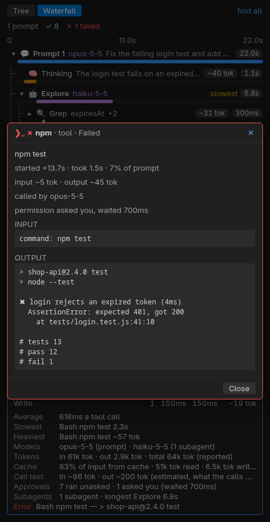
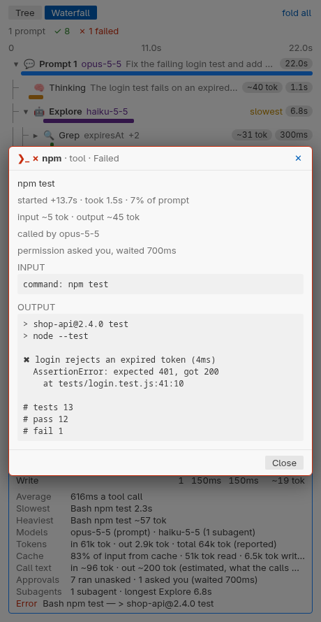

# Agent Call Stack for Claude (VS Code)

See what Claude Code is doing while it works: a live call stack in VS Code's side bar, for [Claude Code's VS Code extension](https://code.claude.com/docs/en/vs-code). Each prompt, what the model thought and replied between calls, the subagents it started and the tool calls inside them, with status, duration, the model, the tokens the API counted, what you were asked to approve, errors and compactions. It draws as a tree or a waterfall, and a click opens a row's input and output.

<p align="center">
  
  
</p>
<p align="center"><sub>A made-up session ("fix the failing login test"), drawn by the extension's own code. The pictures are generated by <code>scripts/screenshots</code> in the repository.</sub></p>

Part of [Agent Call Stack](https://github.com/Rickedb/agent-call-stack#readme). It is an extension of its own: it is not the [Copilot one](https://github.com/Rickedb/agent-call-stack/tree/master/vscode#readme), and it does not need the [Claude Code mod](https://github.com/Rickedb/agent-call-stack/tree/master/claude#readme).

## Getting started

1. **Install** the extension: from the Marketplace, or from a `.vsix` (`npm run package`, then *Extensions: Install from VSIX...*; see Develop).
2. **Open the view**: the **Agent Call Stack for Claude** icon in the Activity Bar.
3. **Add the hooks to your Claude Code settings.** Until they are there, the view offers two buttons: **Add to your settings** (all workspaces) or **This workspace only**. Pick one: both would record every call twice. A backup of the file is kept, and **Remove Hooks from Claude Code Settings** takes out only the extension's own entries.
4. **Send a prompt to Claude Code.** A session that was already open when the hooks were added picks them up when it starts again.

The newest prompt is on top. When a prompt starts, the ones before it fold away (open any again with its arrow, or use *fold all* / *unfold all*).

**Requirements:** VS Code 1.95+, Claude Code settings that do not turn hooks off (`disableAllHooks`), and `node`, which is found automatically (with none, VS Code runs the hooks itself). Details, including Windows: [Reference](https://github.com/Rickedb/agent-call-stack#reference).

**Commands and settings.** *Open Call Stack*, *Add Hooks to Claude Code Settings*, *Remove Hooks from Claude Code Settings*, *Clear Recorded Calls*. Settings: `agentCallStackClaude.defaultView` and `agentCallStackClaude.useElectronAsNode`.

## What it shows

- Prompts, subagents and tool calls, nested as a tree or as bars on a time axis.
- What the model thought and replied between calls.
- The model each prompt and subagent ran on, and the tokens the API counted (with the cache split).
- Which calls you were asked to approve, and what you answered.
- What each call involved (files, commands, searches, addresses), its duration, its output size and whether it failed.
- A summary of every finished prompt, with a markdown copy; errors and compactions as rows of their own.

## A tour

### Waterfall

Every row is a bar on one time axis, so you see what ran when, how long each call took, and what overlapped. The bar's color says done, running or slowest; only a failure keeps its `✗`.


### Tree

The same rows, nested: a subagent holds the calls it made, guide lines draw the branches, and every row has a status mark (`✓` done, `●` running, `✗` failed). The model's `Thinking` and `Reply` text sit in order between the calls.


### A row's details

A click opens a row in a modal: its state and timing, how much of the prompt it took, the size of its input and output, who it ran with, the model it ran on (`opus-5-5`, `haiku-5-5`, in color after the name), and whether you were asked to approve it (here `npm test` was, and you let it run after 700 ms), and the input and output themselves (*Show all*, copy icon). Here, a failing `npm test`:



### The summary

When a prompt has finished, a summary ends its rows (the bottom of every picture above): calls, failures and time, one line per tool, the slowest and heaviest call, tokens; the figures the API reported (`61k tok in`, 83% from the cache), the models, and how many calls ran unasked, were asked or were refused. Its **Copy** button puts it on the clipboard as markdown, for a ticket or a PR.

### Light themes and first run

It follows your VS Code theme (the colors are the theme's own). Before the hooks are installed, the view says so and offers the buttons that install them:

<p>
  
  
  
</p>

## Good to know

- Models, tokens, and Thinking and Reply rows are read from Claude Code's transcript, so they show a moment after a turn ends.
- What the chat held before the hooks were added is read back from the transcript, without approvals or exact times.
- Hooks only tell of a call when you are asked or a classifier refuses it, so the other calls carry no approval information.
- A prompt you cancel (Esc or the stop button) shows as `interrupted` a moment after, read from the transcript; Claude Code doesn't run `Stop` for a cancel.

All the details, and how it differs from the other targets, are in the [Reference](https://github.com/Rickedb/agent-call-stack#reference).

## Develop

```bash
cd claude-vscode
npm install
npm test            # compiles, then runs the unit tests
npm run package     # makes a .vsix for "Install from VSIX..."
```

To run it from source, open the `claude-vscode/` folder in VS Code and press F5, then add the hooks in that window.
