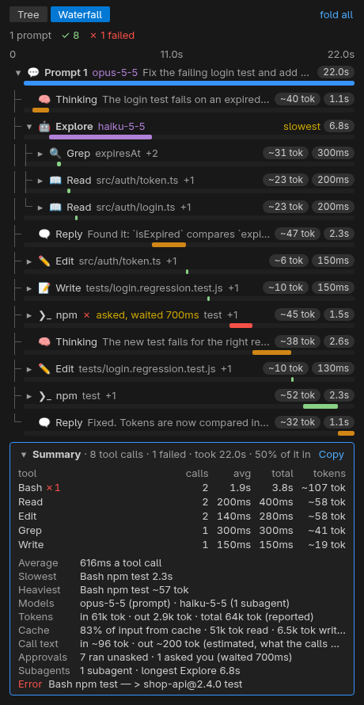
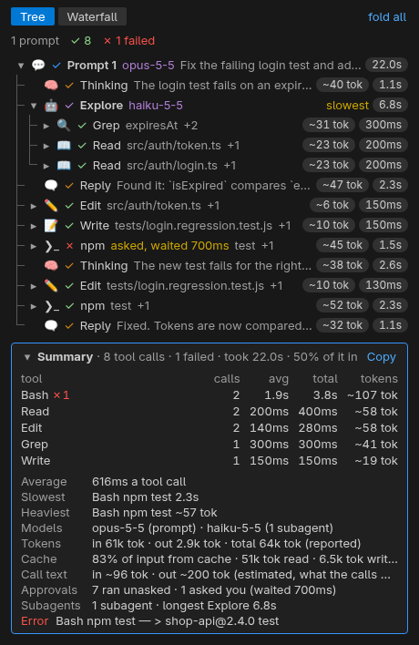
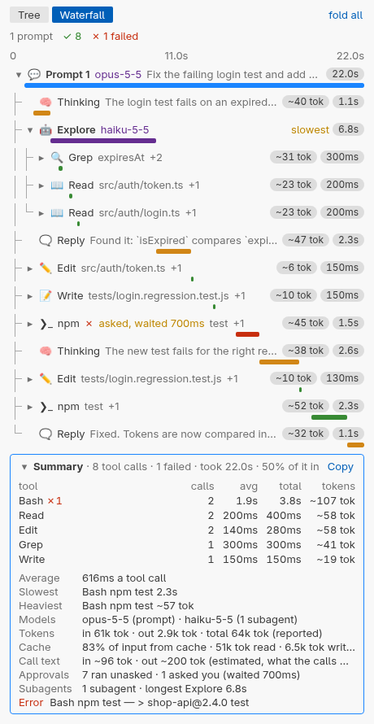
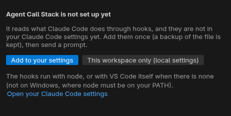

# Agent Call Stack for Claude (VS Code)

See what Claude Code is doing while it works: a live call stack in VS Code's side bar, for [Claude Code's VS Code extension](https://code.claude.com/docs/en/vs-code). Each prompt, what the model thought and replied between calls, the subagents it started and the tool calls inside them, with status, duration, the model, the tokens the API counted, what you were asked to approve, errors and compactions. It draws as a tree or a waterfall, and a click opens a row's input and output.

<p align="center">
  
  
</p>
<p align="center"><sub>A made-up session ("fix the failing login test"), drawn by the extension's own code. The pictures are generated by <code>scripts/screenshots</code> in the repository.</sub></p>

Part of [Agent Call Stack](../README.md). It is an extension of its own: it is not the [Copilot one](../vscode/README.md), and it does not need the [Claude Code mod](../claude/README.md).

## Getting started

1. **Install** the extension: from the Marketplace, or from a `.vsix` (`npm run package`, then *Extensions: Install from VSIX...*; see Develop).
2. **Open the view**: the **Agent Call Stack for Claude** icon in the Activity Bar.
3. **Add the hooks to your Claude Code settings.** Until they are there, the view says so and offers two buttons: **Add to your settings** (`~/.claude/settings.json`) or **This workspace only** (`.claude/settings.local.json`, which Claude Code keeps out of git: the entries hold a path on your machine). Pick one: both would record every call twice. Adding keeps a copy of the file the first time (`settings.json.agent-call-stack.bak`), changes nothing but the hooks, and refuses a file that is not JSON. **Remove Hooks from Claude Code Settings** takes out only its own entries. A notification offers the same on first start.
4. **Send a prompt to Claude Code.** A session that was already open when the hooks were added picks them up when it starts again.

The newest prompt is on top. When a prompt starts, the ones before it fold away (open any again with its arrow, or use *fold all* / *unfold all*).

**Requirements**

- VS Code 1.95+, and Claude Code settings that do not turn hooks off (`disableAllHooks`; the view says so when they do).
- `node`. The hooks run `node record.cjs <Event>`, and the install writes node's full path into them, so a `node` that only your shell config puts on `PATH` (mise, nvm, ...) works too. With no `node` found, the hooks run VS Code itself as node (`ELECTRON_RUN_AS_NODE`). The setting `agentCallStackClaude.useElectronAsNode` makes that the choice. Windows has neither: it needs `node` on `PATH`.

**Commands and settings.** *Open Call Stack*, *Add Hooks to Claude Code Settings*, **Remove Hooks from Claude Code Settings**, **Clear Recorded Calls**. Settings: `agentCallStackClaude.defaultView` (Tree or Waterfall at first) and `agentCallStackClaude.useElectronAsNode`. Reload the window after changing the second.

## A tour

### Waterfall

Every row is a bar on one time axis, so you see what ran when, how long each call took, and what overlapped. The bar's color says done, running or slowest; only a failure keeps its `✗`.


### Tree

The same rows, nested: a subagent holds the calls it made, guide lines draw the branches, and every row has a status mark (`✓` done, `●` running, `✗` failed). The model's `Thinking` and `Reply` text sit in order between the calls.


### A row's details

A click opens a row in a modal: its state and timing, how much of the prompt it took, the size of its input and output, who it ran with, the model it ran on (`opus-5-5`, `haiku-5-5`, in color after the name), and whether you were asked to approve it (here `npm test` was, and you let it run after 700 ms), and the input and output themselves (*Show all*, copy icon). Here, a failing `npm test`:


### The summary

When a prompt has finished, a summary ends its rows (the bottom of every picture above): calls, failures and time, one line per tool, the slowest and heaviest call, tokens; the figures the API reported (`61k tok in`, 83% from the cache), the models, and how many calls ran unasked, were asked or were refused. Its **Copy** button puts it on the clipboard as markdown, for a ticket or a PR. More under *Summary of a finished prompt*.

### Light themes and first run

It follows your VS Code theme (the colors are the theme's own). Before the hooks are installed, the view says so and offers the buttons that install them:

<p>
  
  
  
</p>

## How it works

Claude Code runs the hooks of its settings wherever it runs, the VS Code extension included, so the port has two parts, as the Copilot one has:

1. **A hook script** (`src/record.ts`, installed as `~/.claude/agent-call-stack-vscode/record.cjs`). Claude Code runs it on each event. It appends one normalized line to `~/.claude/agent-call-stack-vscode/events/<session>.jsonl`, prints nothing (for a hook, "no decision": it never blocks or denies anything) and swallows its own errors. Texts over 8,000 characters are cut in the log and kept whole in `blobs/`.
2. **A VS Code extension** (`src/extension.ts`) that tails those logs, reads the model and token counts from Claude Code's transcript, and draws the pane in the side bar (the Activity Bar's **Agent Call Stack for Claude** icon).

What maps to what:

| Claude Code mod | This extension |
| --- | --- |
| `turn.start` / `turn.complete` | `UserPromptSubmit` / `Stop` (`StopFailure` when the API failed) |
| `tool.call` | `PreToolUse` / `PostToolUse` / `PostToolUseFailure` (exact: every call has an id) |
| `agent.spawn` | `SubagentStart` / `SubagentStop` (plus the spawn call's description) |
| `tool.check` | `PermissionRequest` / `PermissionDenied` (only for a call you were asked about) |
| `session.compact` | `PreCompact` / `PostCompact` |
| a turn's reported usage and model | the transcript Claude Code keeps (`transcript_path` in every payload) |
| `turn.step`'s text and thinking chunks (the `Thinking` and `Reply` rows) | the same transcript's `text` and `thinking` blocks, a moment later |
| `ui.open` pane | the side bar view |

## Reading the tree

- **Nesting.** A subagent is a row, and the calls it makes are its children (exact: a call carries its subagent's id). Guide lines (`├─ └─`) draw the branches. Neither Claude Code's hooks nor its engine say which tool call started another, so a tool that calls other tools shows as siblings.
- **What a call involved.** Under a tool call's row, in the tree and the waterfall, once you open it, one row for each thing it involved: a file (its name only, with what was done to it and, for an edit, its lines: `◦ login.ts edit +2 −1`), an address it fetched (`↗ x.dev/docs/auth fetch`, the scheme left off), the command it ran (`$ npm test run`), what it searched for (`? login search`). The rows have no time or bar of their own. A click on one opens in the modal the whole path, address or command, what the call did, and every call of the prompt that involved the same one (each a button that opens that call's details), with their lines in all; *Open the call* goes to the call itself. They are shut until you open them: a call with something under it has an arrow (`▸`, and a `+2` after it counting them), and a click on it opens them (`▾`) or shuts them again; *fold all* shuts them too. Over eight, the rest are counted (`+3 more`). They are read from what each call was given, (see *What a call touched*), so they show while the call runs.
- **What the model wrote between calls.** A `Thinking` row (🧠) and a `Reply` row (🗨️) sit in time order among the calls, under the prompt or subagent whose loop wrote them: the text the model wrote before it asked for a call ("I'll read the config first"), and its reasoning. They are read from the transcript (hooks carry none of it), so they show a moment after they are written, and a subagent's once it has stopped (its own transcript's path comes with its stop). A row's time runs from the line before it in the transcript to the line itself, so it is the model's own time on that block; its badge is the text's estimated tokens; its details show the text (cut at 8,000 characters). Thinking shows only when the model returned its text: some models and settings return a signature and no text, and then there is no row. They are not calls: the summary and the counts leave them out. Earlier chat (History) gets them too, since they come from the same file.
- **Names and icons.** A shell call is named by the first command it runs that is not a common call: `cd /app && npm test` is `npm` with `test` after it, and `cd`, `pushd`, `export`, `set`, `source`, `clear`, `Set-Location`, `$env:X = ...` and the like only say where or with what, so they are passed over (so are `VAR=x` settings before a program). A line that runs no program of its own is named by its shell: `bash`, or `pwsh` for a PowerShell call (by the tool's name, a cmdlet such as `Get-ChildItem`, or a `$env:` setting). The icon says what the call did: `❯_` for a command (the terminal's prompt), 📖 read, ✏️ edit, 📝 write, 🔍 search, 🌐 fetch; `🔌` a tool an MCP server gave the agent (named `mcp__server__tool`, or `mcp_server_tool` in Copilot), whatever it touched; a call that touched nothing mapped keeps the 🔧 tool icon. The summary still groups by the tool's own name.
- **The commands of a shell call.** Its details list the commands of the line as a tree, names only, in the order they run: pipelines joined by `&&` (next runs if this succeeded), `||` (if it failed), `;` and `&` at the top, and each pipeline's later commands under the one that feeds them, after a `|` (or `|&`). Each operator has its own color, and a line under the tree says what the ones used mean. The common calls are dim. A line of one command shows no tree. Quotes and `$(...)` hide the operators inside them.
- **Details.** Click a row to open its details in a modal: its state, timing, token sizes, the model, what you were asked, and its input and output (*Show all*, *Copy*, the transcript path). The ✕, Close, a click outside it, or Esc closes it.
- **Badges and copy.** A row's output size and time are badges (the time is what the call itself took, a prompt's its total; the bar shows where it started). Each text has a copy icon in its code block's corner.
- **Status marks.** The tree puts a glyph on every row (`✓` done, `●` running, `✗` failed). The waterfall does not: the bar's color already says it, so only a failure keeps its `✗`.
- **Parallel calls are not marked**: overlap in time alone cannot tell parallel from coincidence. In the waterfall, overlapping bars still show what ran together.

## Models and tokens

A prompt and each subagent show the model that answered, in color after their name (`opus-5-5`; the date a model id carries is dropped). Tokens are of two kinds:

- **Reported** (`4.8k tok`, no `~`): what the API counted for a prompt's turns and for each subagent's loop, read from the transcript. A prompt's excludes its subagents, which have their own rows. The summary adds them up and says how much came from the cache.
- **Estimated** (`~340 tok`): a tool call's input and output, and the text of a prompt or subagent, at four characters a token. The summary's "Call text" line.

Claude Code's hooks carry neither, so both come from its transcript. The transcript's format is Claude Code's own and not documented, and it is written asynchronously: a turn's figures show a moment after it ends, a subagent's once it has stopped, and nothing shows if the format changes. The reader goes on from where it was in the file, so a long one is not read again.

## Errors, compactions and approvals

- **Errors.** A prompt that did not end in an answer says why, in red after its name: what the API said (`rate limited: …`, `API overloaded`, `billing error`), or `session ended` when the session closed on it. A failed call keeps its error as its output. The summary lists every failure (the prompt, subagents, calls, with the first line of each error), five at most.
- **Compactions.** A `Compact` row from `PreCompact` to `PostCompact`, under what was running, with its trigger (`manual` or `auto`), the instructions it was given (input), the summary it left (output) and, from the transcript, `180k → 12k tok`. The summary of the prompt adds them up.
- **Approvals.** A call you were asked about is tagged `asking you` while it waits, then `asked, waited 4.2s`; one not allowed is tagged `not allowed` (you said no, or a classifier did, with its reason). Claude Code reports how long the tool itself ran (`duration_ms`, without your answer), so the row is drawn from when it ran and the wait is told apart; the summary says how many calls ran unasked, how many you were asked about, and how long you were waited on.

Error and compaction rows count as neither calls nor failed calls in the totals.

## What a call touched

The resource rows under a tool call (see *Reading the tree*) are read from what the call was given, by the tool's name and the shape of its arguments, so they also work for tools it has not seen. The **lines** count what the call's arguments say: an edit counts the lines that differ between the text it replaces and its replacement (what the two share at the start and the end is left out), a file written whole counts as added only (the call does not say what was there), and a failed call counts for nothing. A change made by a shell command (`sed -i`, `git checkout`) is not counted. The rows and the lines come only with calls recorded after this update.

## History

When the view first draws a session, what the chat held before the hooks were added (or before a resumed session started) is read back from Claude Code's transcript, like the mod reads the chat when it loads: the prompts, each call with what came back, subagent calls, and the compactions, newest 30 prompts at most and the end of a transcript over 64 MB. They go before the recorded ones, folded as older prompts are, marked in their details as read back. A prompt the hooks began in the middle of takes its words and earlier calls from the transcript and keeps what the hooks saw. Rows read back have the times the lines were written (a wait for you is in them), no verdicts, and no inside of a subagent. A session that never fired a hook is not known to the view, so it has no history either.

## Summary of a finished prompt

When a prompt has finished and made at least one call, a summary ends its rows: the calls, how many failed and how long they ran of the prompt's time; one line per tool (calls, average, total, tokens); the average, slowest and heaviest call; the models; the tokens (reported, with the cache and the call text estimate) ; approvals, compactions, subagents and errors. It collapses to its header with `▾ Summary`, and **Copy** puts it on the clipboard as markdown.

## Differences from the Claude Code mod and the Copilot port

- **History has no verdicts and wall-clock times.** What the chat held before the hooks is read back from the transcript (see History), where a call's time includes any wait for you and nothing says what you were asked.
- **Approvals are partial.** The hooks tell of a call only when you are asked or a classifier refuses it, so there is no rule name for the rest, which show nothing.
- **No refusal category, no cut-off replies, no compaction cost.** Those are engine events the mod sees (`turn.step`, `session.compact`); a hook does not.
- **Thinking and reply rows come a moment late too**, from the same file: the mod streams them live (running, then settled), the extension draws each once its line is written, and a subagent's once it has stopped.
- **Tokens and models come a moment late**, and from a file whose format may change (see above).
- **No `/call-stack` and no `@callstack`.** The view's icon, or the command, opens it.
- **A hook install step**, which merges into your settings (see Use).

`AGENTS.md` at the repository root lists these with the reasons.

## Layout

```
src/record.ts         the hook script: a Claude Code payload to one log line, what a call touched
src/hooks.ts          adding our hooks to a settings file, and taking them out (pure merge, backup)
src/store.ts          tails the event logs
src/model.ts          folds events into rows: calls, subagents, asks, compactions, failures
src/transcript.ts     reads the model and usage of each prompt and subagent from the transcript
src/history.ts        reads the earlier prompts, calls and compactions back from the transcript
src/stats.ts          the summary's numbers; src/resources.ts what a call involved; src/names.ts a call's name on its row
src/extension.ts      the view, the commands, the installer
src/view/             the panel's drawing: rows, modal, blocks, report, markdown, sequence, toolbar, tags, format
media/                the webview's script and stylesheet
```

## Develop

```bash
cd claude-vscode
npm install
npm test            # compiles, then runs the unit tests (recorder, installer, rows, transcript, views)
npm run build
npx @vscode/vsce package   # makes a .vsix to install with "Install from VSIX..."
```

To run it from source, open the `claude-vscode/` folder in VS Code and press F5 (Extension Development Host), then add the hooks in that window. The recorder takes `AGENT_CALL_STACK_CLAUDE_DIR` for its folder, which tests use (the installer only recognizes its entries when the recorder sits in a folder named `agent-call-stack-vscode`).
