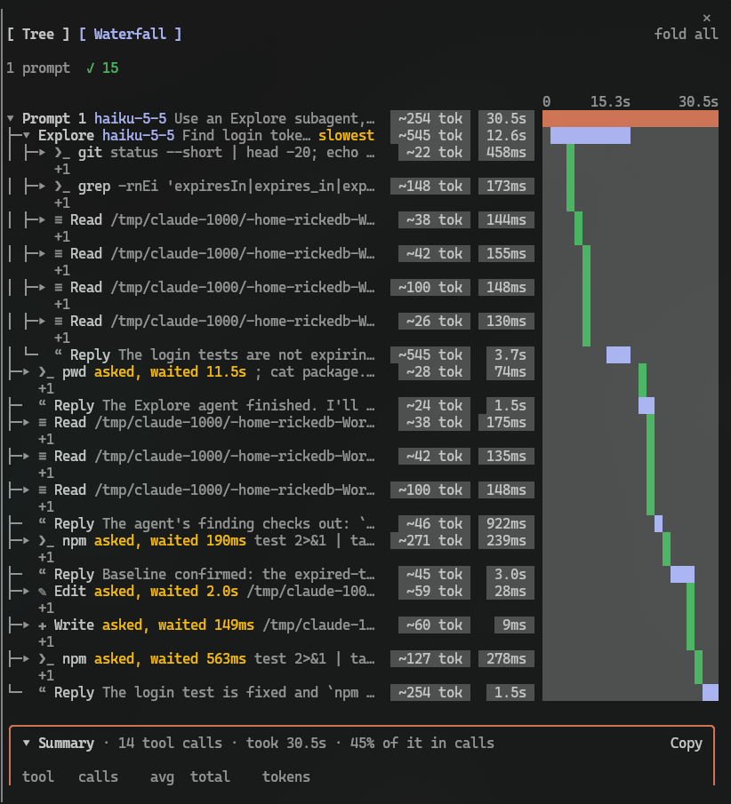
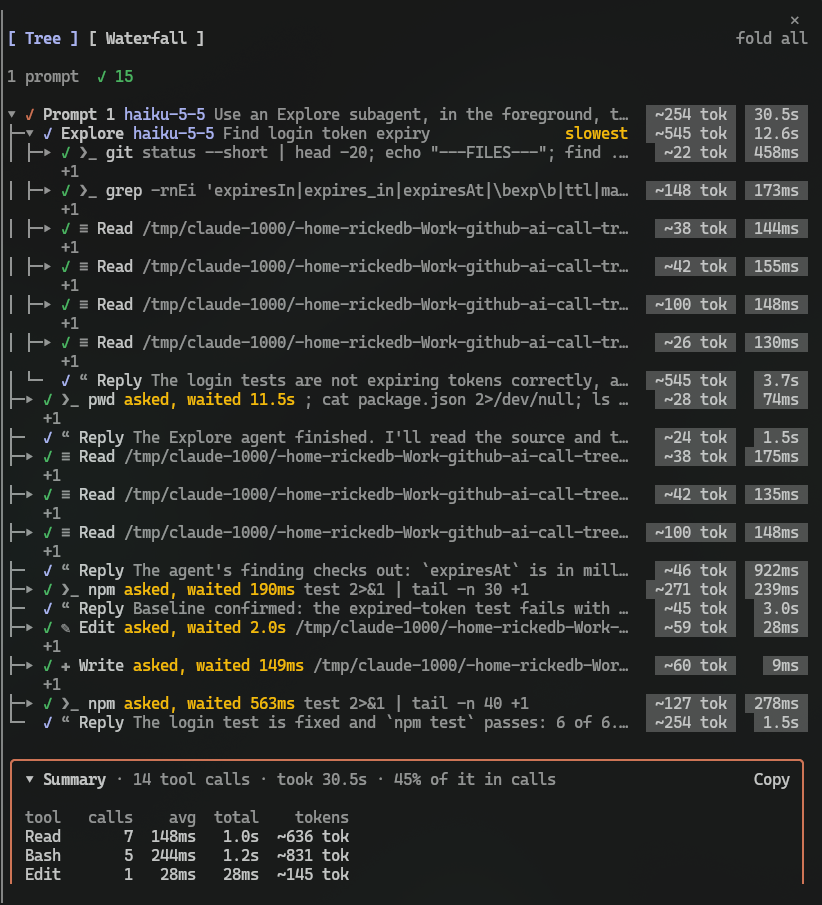
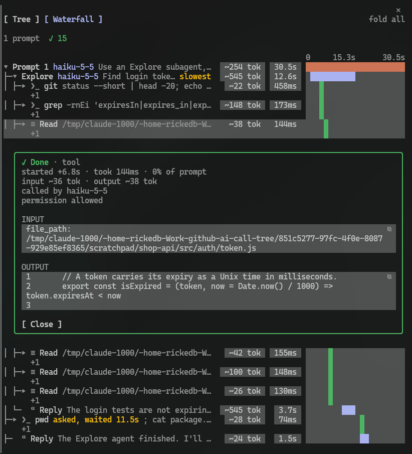
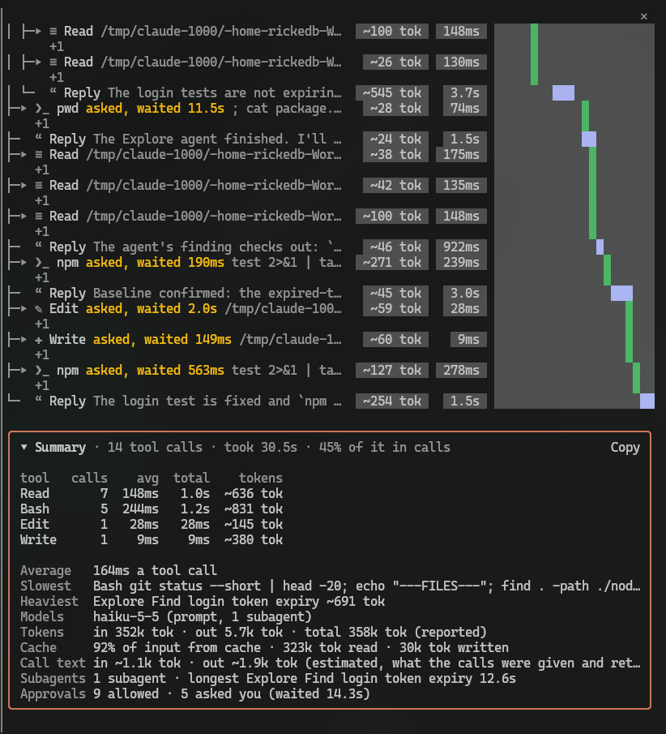

# Agent Call Stack for Claude Code

A live "Agent Call Stack" pane beside the Claude Code chat, as a Claude Code mod. It shows what Claude is doing like a stack trace: each prompt, what the model thought and replied between calls, the subagents it started and the tool calls inside them, with status, duration, the model, the tokens the API counted, what you were asked to approve, errors and compactions. Running calls are listed at the top as the current stack, innermost first. It draws as a tree or a waterfall, and a row opens its input and output inline.

Part of [Agent Call Stack](https://github.com/Rickedb/agent-call-stack#readme), which also has the same view for [Claude Code in VS Code](https://github.com/Rickedb/agent-call-stack/tree/master/claude-vscode#readme) and [GitHub Copilot](https://github.com/Rickedb/agent-call-stack/tree/master/vscode#readme).

<p align="center">
  
  
</p>
<p align="center"><sub>Real screenshots of the pane in a Claude Code terminal session: Claude fixing a failing test in a small demo project, with an Explore subagent. Nothing is mocked.</sub></p>

## Getting started

1. **Install** from the marketplace at the repo root:

   ```
   /plugin install agent-call-stack --marketplace Rickedb/agent-call-stack
   ```

   To try it from a checkout instead, run `claude --plugin-dir <this folder>` (this folder is `claude/`).
2. **Start a session.** The pane opens at session start. Run `/call-stack` to open it again.
3. **Click a row** to open its details inline, under the row. (The engine has no modal API; the VS Code extensions open them in a modal. See `AGENTS.md`.)

## What it shows

- Prompts, subagents and tool calls, nested as a tree or as bars on a time axis.
- What the model thought and replied between calls.
- The model each prompt and subagent ran on, and the tokens the API counted (with the cache split).
- Which calls you were asked to approve, were refused, or ran unasked.
- What each call involved (files, commands, searches, addresses), its duration, its output size and whether it failed.
- A summary of every finished prompt, with a markdown copy; errors and compactions as rows of their own.

## A tour

**Waterfall** and **Tree** are the two views at the top; the calls a subagent made nest under it. A call that waited for you to approve it says so (`asked, waited 2.0s`) and its bar starts when the tool ran, not when you were asked.

**A row's details** open inline, under the row you click: its state and timing, the size of its input and output, who it ran with, and the input and output themselves (here, a `Read` of the file with the bug).

<p align="center">
  
</p>

**The summary** ends each finished prompt: calls, failures and time, a line per tool, the slowest and heaviest call, the models, the tokens the API counted with the cache split, and how many calls ran unasked or were asked about. Its **Copy** button puts it on the clipboard as markdown.

<p align="center">
  
</p>

## Good to know

- Details open inline, under the row (the engine has no modal API; the VS Code extensions use a modal).
- The chat's earlier messages are read in when the mod loads, as prompts and calls, without Thinking and Reply rows or exact times.
- The same view exists for [Claude Code in VS Code](https://github.com/Rickedb/agent-call-stack/tree/master/claude-vscode#readme) and [GitHub Copilot](https://github.com/Rickedb/agent-call-stack/tree/master/vscode#readme).

All the details (reading the tree, tokens, models, errors, the summary, the code layout) are in the [Reference](https://github.com/Rickedb/agent-call-stack#reference).

## Develop

```bash
claude plugin validate .   # checks the manifest and reads the hooks module as the engine will
claude plugin test .       # runs agent-call-stack.test.tsx
```

Run these from this folder (`claude/`). Load it in a session with `claude --plugin-dir <this folder>`.
