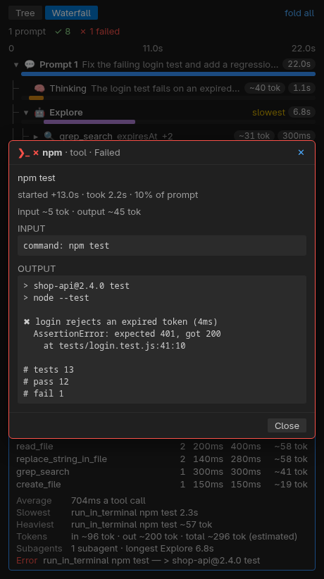
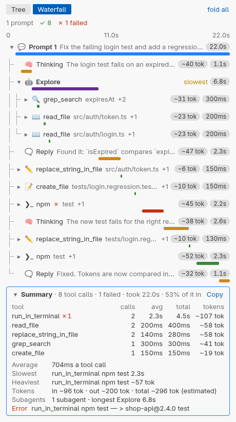

# Agent Call Stack for GitHub Copilot

See what Copilot's agent is doing while it works: a live call stack in VS Code's side bar. Each prompt, what the model thought and replied between calls, the subagents it started and the tool calls inside them, with status, duration and the size of each output in tokens. It draws as a tree or a waterfall, and a click opens a row's input and output.

<p align="center">
  
  
</p>
<p align="center"><sub>A made-up session ("fix the failing login test"), drawn by the extension's own code. The pictures are generated by <code>scripts/screenshots</code> in the repository.</sub></p>

Part of [Agent Call Stack](https://github.com/Rickedb/agent-call-stack#readme), which also has a [Claude Code mod](https://github.com/Rickedb/agent-call-stack/tree/master/claude#readme) and an [extension for Claude Code in VS Code](https://github.com/Rickedb/agent-call-stack/tree/master/claude-vscode#readme). This is the Copilot port of the mod.

## Getting started

1. **Install** the extension: from the Marketplace, or from a `.vsix` (`npm run package`, then *Extensions: Install from VSIX...*; see Develop).
2. **Open the view**: the **Agent Call Stack** icon in the Activity Bar (on the side, not in the bottom panel with Terminal). To keep it beside Copilot Chat, drag the icon to the Secondary Side Bar: VS Code remembers.
3. **Install the hooks.** Until they are, the view offers two buttons: **Install for all workspaces** or **This workspace only**. Pick one: both would record every call twice. The workspace file holds a path on your machine, so do not commit it.
4. **Start a new Copilot agent chat.** The calls show up in the view (or open it with **Agent Call Stack: Open Call Stack**).

The newest prompt is on top. When a prompt starts, the ones before it fold away (open any again with its arrow, or use *fold all* / *unfold all*).

**Requirements:** VS Code 1.95+ with agent hooks enabled (`chat.useHooks`; they are a preview feature), and `node`, which is found automatically (with none, VS Code runs the hooks itself). Details, including Windows: [Reference](https://github.com/Rickedb/agent-call-stack#reference).

**Commands and settings.** *Open Call Stack*, *Install Copilot Hooks*, *Remove Copilot Hooks*, *Clear Recorded Calls*, and `@callstack` in chat for the tree as text. Settings: `agentCallStack.defaultView` and `agentCallStack.useElectronAsNode`.

## What it shows

- Prompts, subagents and tool calls, nested as a tree or as bars on a time axis.
- What the model thought and replied between calls.
- What each call involved (files, commands, searches, addresses), its duration, its output size in tokens and whether it failed.
- A summary of every finished prompt, with a markdown copy for a ticket or a PR.
- Errors and compactions as rows of their own.

## A tour

### Waterfall

Every row is a bar on one time axis, so you see what ran when, how long each call took, and what overlapped. The bar's color says done, running or slowest; only a failure keeps its `✗`.


### Tree

The same rows, nested: a subagent holds the calls it made, guide lines draw the branches, and every row has a status mark (`✓` done, `●` running, `✗` failed). The model's `Thinking` and `Reply` text sit in order between the calls.


### A row's details

A click opens a row in a modal: its state and timing, how much of the prompt it took, the size of its input and output, who it ran with (the model that called it, when VS Code's chat log says), and the input and output themselves (*Show all*, copy icon). Here, a failing `npm test`:



### The summary

When a prompt has finished, a summary ends its rows (the bottom of every picture above): calls, failures and time, one line per tool, the slowest and heaviest call, tokens; estimates, as Copilot's hooks carry no counts. Its **Copy** button puts it on the clipboard as markdown, for a ticket or a PR.

### Light themes and first run

It follows your VS Code theme (the colors are the theme's own). Before the hooks are installed, the view says so and offers the buttons that install them:

<p>
  
  
  
</p>

## Good to know

- Only what happens after the hooks are installed is recorded; earlier chat is not read back.
- Token figures are estimates, and the model is read from VS Code's own chat log, so it can be missing: Copilot's hooks give neither.
- There is no approval information, and Thinking and Reply rows show after a prompt ends.
- A prompt you cancel (Esc or the stop button) shows as `interrupted` a moment after, read from the agent's log; Copilot's hooks don't tell of it.

All the details, and how it differs from the Claude Code targets, are in the [Reference](https://github.com/Rickedb/agent-call-stack#reference).

## Develop

```bash
cd vscode
npm install
npm test            # compiles, then runs the unit tests
npm run package     # makes a .vsix for "Install from VSIX..."
```

To run it from source, open the `vscode/` folder in VS Code and press F5, then install the hooks in that window.
