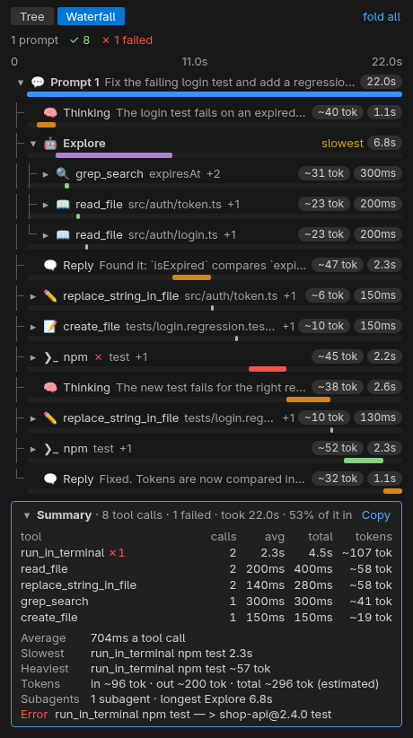
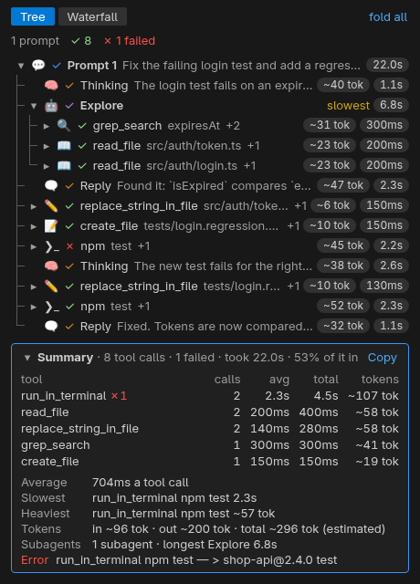
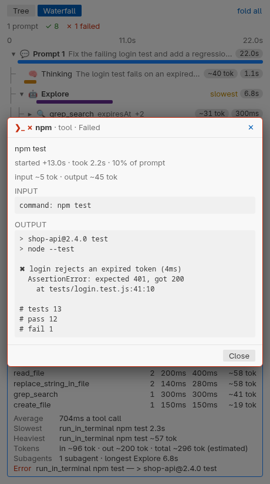
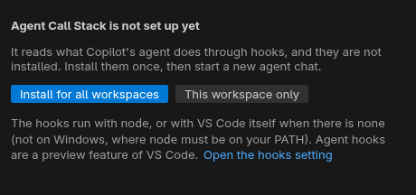

# Agent Call Stack for GitHub Copilot

See what Copilot's agent is doing while it works: a live call stack in VS Code's side bar. Each prompt, what the model thought and replied between calls, the subagents it started and the tool calls inside them, with status, duration and the size of each output in tokens. It draws as a tree or a waterfall, and a click opens a row's input and output.

<p align="center">
  
  
</p>
<p align="center"><sub>A made-up session ("fix the failing login test"), drawn by the extension's own code. The pictures are generated by <code>scripts/screenshots</code> in the repository.</sub></p>

Part of [Agent Call Stack](../README.md), which also has a [Claude Code mod](../claude/README.md) and an [extension for Claude Code in VS Code](../claude-vscode/README.md). This is the Copilot port of the mod.

## Getting started

1. **Install** the extension: from the Marketplace, or from a `.vsix` (`npm run package`, then *Extensions: Install from VSIX...*; see Develop).
2. **Open the view**: the **Agent Call Stack** icon in the Activity Bar (on the side, not in the bottom panel with Terminal). To keep it beside Copilot Chat, drag the icon to the Secondary Side Bar: VS Code remembers.
3. **Install the hooks.** Until they are, the view says so and offers two buttons: **Install for all workspaces** (`~/.copilot/hooks/agent-call-stack.json`) or **This workspace only** (`.github/hooks/agent-call-stack.json`). Pick one: both would record every call twice. The workspace file holds an absolute path on your machine, so do not commit it. A notification offers the same on first start, and so do the view's `…` menu and **Agent Call Stack: Install Copilot Hooks**.
4. **Start a new Copilot agent chat.** The calls show up in the view (or open it with **Agent Call Stack: Open Call Stack**).

The newest prompt is on top. When a prompt starts, the ones before it fold away (open any again with its arrow, or use *fold all* / *unfold all*).

**Requirements**

- VS Code 1.95+, with agent hooks enabled. They are a preview feature: if nothing shows up, check the `chat.useHooks` setting and that your organization does not disable them.
- `node`. The hooks run `node record.cjs <Event>`, and the install writes node's full path into them, so a `node` that only your shell config puts on `PATH` (mise, nvm, ...) works too. With no `node` found, the hooks run VS Code itself as node (`ELECTRON_RUN_AS_NODE`). The setting `agentCallStack.useElectronAsNode` makes that the choice. Windows has neither: it needs `node` on `PATH`.

**Commands and settings.** *Open Call Stack*, *Install Copilot Hooks*, **Remove Copilot Hooks**, **Clear Recorded Calls**; `@callstack` in chat prints the tree as text. Settings: `agentCallStack.defaultView` (Tree or Waterfall at first) and `agentCallStack.useElectronAsNode`. Reload the window after changing the second.

## A tour

### Waterfall

Every row is a bar on one time axis, so you see what ran when, how long each call took, and what overlapped. The bar's color says done, running or slowest; only a failure keeps its `✗`.


### Tree

The same rows, nested: a subagent holds the calls it made, guide lines draw the branches, and every row has a status mark (`✓` done, `●` running, `✗` failed). The model's `Thinking` and `Reply` text sit in order between the calls.


### A row's details

A click opens a row in a modal: its state and timing, how much of the prompt it took, the size of its input and output, who it ran with (the model that called it, when VS Code's chat log says), and the input and output themselves (*Show all*, copy icon). Here, a failing `npm test`:


### The summary

When a prompt has finished, a summary ends its rows (the bottom of every picture above): calls, failures and time, one line per tool, the slowest and heaviest call, tokens; estimates, as Copilot's hooks carry no counts. Its **Copy** button puts it on the clipboard as markdown, for a ticket or a PR. More under *Summary of a finished prompt*.

### Light themes and first run

It follows your VS Code theme (the colors are the theme's own). Before the hooks are installed, the view says so and offers the buttons that install them:

<p>
  
  
  
</p>

## How it works

Copilot has no in-process plugin API like Claude Code's mods, so the port has two parts:

1. **A hook script** (`src/record.ts`, installed as `~/.copilot/agent-call-stack/record.cjs`). Copilot [agent hooks](https://code.visualstudio.com/docs/copilot/customization/hooks) run it on each event (`UserPromptSubmit`, `PreToolUse`, `PostToolUse`, `SubagentStart`, ...). It appends one normalized line to `~/.copilot/agent-call-stack/events/<session>.jsonl`. It never blocks or denies anything, prints `{}`, and swallows its own errors. Texts over 8,000 characters are cut in the log and kept whole in `blobs/`.
2. **A VS Code extension** (`src/extension.ts`) that tails those logs and draws the pane in the side bar (the Activity Bar's **Agent Call Stack** icon), with the same Tree / Waterfall views, folding, details, "Show all" and copy buttons.

What maps to what:

| Claude Code mod | Copilot port |
| --- | --- |
| `turn.start` / `turn.complete` | `UserPromptSubmit` / `Stop` |
| `tool.call` | `PreToolUse` / `PostToolUse` / `PostToolUseFailure` |
| `agent.spawn` | `SubagentStart` / `SubagentStop` (plus the spawn tool's description) |
| `ui.open` pane, `/call-stack` | Side bar view, `Agent Call Stack: Open Call Stack`, and `@callstack` in chat (text tree) |
| State atoms | Extension host state (view mode is remembered) |

## Details

Click a row to open its details in a modal over the view: its state, timing, token sizes, who it ran with, and its input and output (*Show all*, *Copy*). The ✕, the Close button, a click outside it, or Esc closes it. Nothing expands inline, so rows never shift. (The Claude Code mod opens details inline: its engine has no modal.)

## Reading the tree

- **Nesting.** A subagent is a row, and the calls it makes are its children. Guide lines (`├─ └─`) draw the branches. Neither Copilot's hooks nor the engine say which tool call started another, so a tool that calls other tools shows as siblings, not as parent and child; only subagents nest.
- **What a call involved.** Under a tool call's row, in the tree and the waterfall, once you open it, one row for each thing it involved: a file (its name only, with what was done to it and, for an edit, its lines: `◦ login.ts edit +2 −1`), an address it fetched (`↗ x.dev/docs/auth fetch`, the scheme left off), the command it ran (`$ npm test run`), what it searched for (`? login search`). The rows have no time or bar of their own. A click on one opens in the modal the whole path, address or command, what the call did, and every call of the prompt that involved the same one (each a button that opens that call's details), with their lines in all; *Open the call* goes to the call itself. They are shut until you open them: a call with something under it has an arrow (`▸`, and a `+2` after it counting them), and a click on it opens them (`▾`) or shuts them again; *fold all* shuts them too. Over eight, the rest are counted (`+3 more`). They are read from what each call was given, (see *What a call touched*), so they show while the call runs. `@callstack` lists them too.
- **Names and icons.** A shell call is named by the first command it runs that is not a common call: `cd /app && npm test` is `npm` with `test` after it, and `cd`, `pushd`, `export`, `set`, `source`, `clear`, `Set-Location`, `$env:X = ...` and the like only say where or with what, so they are passed over (so are `VAR=x` settings before a program). A line that runs no program of its own is named by its shell: `bash`, or `pwsh` for a PowerShell call (by the tool's name, a cmdlet such as `Get-ChildItem`, or a `$env:` setting). The icon says what the call did: `❯_` for a command (the terminal's prompt), 📖 read, ✏️ edit, 📝 write, 🔍 search, 🌐 fetch; `🔌` a tool an MCP server gave the agent (named `mcp__server__tool`, or `mcp_server_tool` in Copilot), whatever it touched; a call that touched nothing mapped keeps the 🔧 tool icon. The summary still groups by the tool's own name.
- **The commands of a shell call.** Its details list the commands of the line as a tree, names only, in the order they run: pipelines joined by `&&` (next runs if this succeeded), `||` (if it failed), `;` and `&` at the top, and each pipeline's later commands under the one that feeds them, after a `|` (or `|&`). Each operator has its own color, and a line under the tree says what the ones used mean. The common calls are dim. A line of one command shows no tree. Quotes and `$(...)` hide the operators inside them.
- **Badges and copy.** A row's output size and time are badges (the time is what the call itself took, a prompt's its total; the bar shows where it started). Each input and output text has a copy icon in the top-right corner of its code block, shown on hover as in a markdown preview, which copies the whole text and turns into a check for a moment; "Copy file path" and "Show all" stay as text buttons below it.
- **Status marks.** The tree puts a glyph on every row (`✓` done, `●` running, `✗` failed). The waterfall does not: the color of a row's bar already says done or running, so only a failure keeps its `✗`, after the name.
- **Parallel calls are not marked.** Copilot's hooks do not say which calls were started together, and overlap in time alone cannot tell parallel from coincidence, so the tree does not guess. In the waterfall, overlapping bars still show what ran at the same moment.

## Tokens

Each row shows the size of its output in tokens (`~340 tok`, hover for what it means), and a row's details show both the input and the output. These are estimates, at four characters a token, from the whole text: Copilot's hooks give no token counts. The Claude Code mod shows the same figures, estimated the same way.

## What a call touched

The resource rows under a tool call (see *Reading the tree*) are read from what the call was given, so they show while it runs: by the tool's name and the shape of its arguments (`filePath`, `command`, `url`, a list of replacements...), which Copilot's tool names make a heuristic: a tool the recorder does not recognize by name still lists the files it was given, as touched in some way (`·`). A call that touches nothing of these has no rows. The **lines** count what the call's arguments say: an edit counts the lines that differ between the text it replaces and its replacement (what the two share at the start and the end is left out), a file written whole counts as added only (the call does not say what was there), and a failed call counts for nothing. A change made by a shell command (`sed -i`, `git checkout`) is not counted. `apply_patch` is read from its patch, which also names its files. Only calls recorded after this update have rows, the lines and the fetched addresses (older logs show none).

## Errors and compactions

- **Errors.** An `ErrorOccurred` event is an `Error` row under what was running, with the message in its name and, in its details, the error's name, its context (`model_call`, `tool_execution`, `system`, `user_input`), whether it was recoverable, and the stack. It does not fail the prompt: the host may go on. A session that ends while a prompt runs (`SessionEnd` with `abort`, `error` or `timeout`) fails the prompt, with `interrupted`, `session error` or `timed out` in red after its name. A failed call keeps its error as its output. The summary lists every failure (the prompt, subagents, calls, with the first line of each error), five at most.
- **Compactions.** A `PreCompact` event is a `Compact` row under what was running, with its trigger (`manual` or `auto`) and the instructions it was given. The hook fires before the compaction and nothing fires after, so the row is an instant: no length, no size before and after, no summary. The summary of the prompt counts them.

Neither counts as a call in the totals. After an update the extension rewrites the hook files it wrote, so the two events are recorded without a reinstall. VS Code's own docs list `PreCompact` but not `ErrorOccurred`; if errors never show up, VS Code does not fire it.

## Transcript

Copilot's hooks name the file the chat's transcript is kept in, on a turn's end (`Stop`), a subagent's start and stop, and a compaction. The row's details show that path, with a button that copies it. A running prompt has none yet, and not every host sends it.

When the transcript is available, the tree also shows a `Thinking` row for the model's reasoning text and a `Reply` row for each nonempty assistant message, under the prompt (or a subagent with its own transcript). They are read from the transcript's `assistant.message` entries, not the hooks; their displayed time runs from the preceding transcript entry to the message. The transcript can be written asynchronously, so these rows may appear shortly after the turn ends. The file format is VS Code's own and undocumented; if it changes, these rows may be unavailable.

## Summary of a finished prompt

When a prompt has finished and made at least one call, a summary ends its rows (not while it runs, when it is folded, or for a prompt read back from history):

- **Calls**: the tool calls, how many failed, how long the prompt took, and how much of that some call was running (overlaps count once).
- **By tool**: one line per tool, the most called first, with its calls, average time, total time and tokens, and its failures.
- **Average**, **slowest** and **heaviest** call (the one that moved the most text, in plus out).
- **Tokens**: in (the prompt and every call's input), out (the answer and every call's output) and the total. Estimates, as above: Copilot's hooks give no token counts. `@callstack` ends with the same figures as text.
- **Subagents**: how many, how many failed, and the longest. They are not counted as tool calls, and their time overlaps their own calls.
- **Compacts** and **Error** lines, as in the section above.

The summary collapses to its header with a click on `▾ Summary` (`▸` when collapsed); the copy button stays in the header. It is remembered until the window reloads.

**Copy** (a button on the summary's header) puts the whole summary on the clipboard as markdown: a bullet list of the figures and a table with every tool, for a ticket, a PR or a chat. `src/view/markdown.ts` builds it.

## Differences from the Claude Code mod

- **Tokens are all estimates.** The Claude Code mod shows what the API reported for a prompt and each subagent, and the cache split; Copilot's hooks carry no usage.
- **The model is read, not given.** Copilot's hooks carry no model, so a prompt's is read from VS Code's own chat log (`chatSessions/<session id>.jsonl` beside the workspace's storage), the model each request was sent to, and matched to the prompts the hooks saw by order from the newest end. It is shown after the prompt's name, in a call's details ("called by"), and in the summary. That file's format is VS Code's own and not documented, so it can change under us; when the model is not found (or the chat is `auto` and says only that), nothing is shown. A subagent has no model of its own here.
- **No permission verdicts.** The Claude Code mod tags a call that was asked about, denied or not allowed, and tells the person's wait from the tool's run time. Copilot's hooks carry no verdict, so a call that waits for you to approve it shows the wait as part of its time.
- **Thinner errors and compactions.** No API error kind, no refusal category, no reply cut off at a limit; a compaction has its trigger and instructions but no size, no length, no summary.
- **No history backfill.** The mod read the chat's earlier messages when it loaded. Here only what happens after the hooks are installed is recorded (the log does survive reloads, so earlier recorded sessions come back).
- **Call pairing is best effort.** Some Copilot hosts give tool calls no id. Then a result is paired with its call by tool and arguments, oldest first, which can swap two identical parallel calls.
- **Subagents.** Copilot's start event may carry no subagent id. Calls inside a subagent are bound to the oldest subagent still waiting for one. The built-in `general-purpose` agent may fire no start/stop events at all (per GitHub's docs), and then it is not drawn.
- A call denied by policy never gets a result; it is drawn as failed when its prompt ends.
- Several concurrent chats each have a session; use the drop-down to switch (default: the newest one in this workspace).

## Layout

Besides the panel, `src/chatmodels.ts` reads the model of each prompt from VS Code's chat log, `src/stats.ts` works out the summary's numbers, and `src/resources.ts` what a call involved, `src/names.ts` a call's name on its row (what a call touched is read in `src/record.ts`).

The panel's drawing is one file a concern in `src/view/`, with `src/render.ts` as its one door:

```
src/view/index.ts     renderBody: toolbar, counts, a section per prompt (newest first), the modal
src/view/rows.ts      a prompt's rows: guide lines, bars
src/view/sequence.ts  a shell call's commands as a tree
src/view/report.ts    the summary of a finished prompt (numbers from src/stats.ts)
src/view/markdown.ts  the summary as markdown, for its copy button
src/view/modal.ts     a row's details in the modal
src/view/blocks.ts    one input or output text, with Show all and Copy
src/view/toolbar.ts   the buttons, the counts, the empty state
src/view/text.ts      the tree as plain text, for @callstack
src/view/context.ts   what one draw works out once (children, times)
src/view/format.ts    escaping, durations, token estimates, status marks
src/view/types.ts     the view state the extension keeps, the draw context
media/                the webview's script (Esc, focus, redraws) and stylesheet
```

## Develop

```bash
cd vscode
npm install
npm test            # compiles, then runs the unit tests (hook script, model, renderer, log tail, installer)
npm run build
npx @vscode/vsce package   # makes a .vsix to install with "Install from VSIX..."
```

To run it from source, open the `vscode/` folder in VS Code and press F5 (Extension Development Host), then install the hooks in that window.

`src/record.ts` accepts both payload styles GitHub documents: snake_case (`PreToolUse`, `tool_name`, `tool_input`) and camelCase (`preToolUse`, `toolName`, `toolArgs`), so it also works if you copy the generated hook entries to a Copilot CLI setup.
